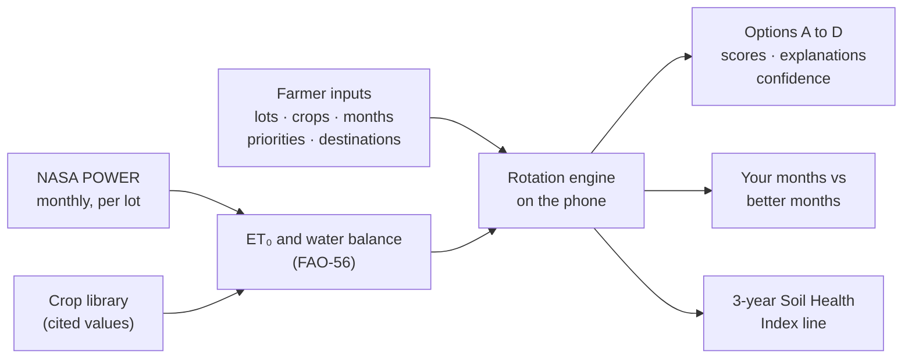

# AgriResilience (working name)

**NASA Space Apps Challenge 2026 · "Field Shift: Adapting Farms with NASA Data"**
Team **Jeoleecation** · Local Event: Iligan City, Philippines

An offline-first app that helps smallholder farmers compare crop-rotation strategies and planting months for each of their lots, using NASA Earth observations, crop characteristics, and the farmer's own priorities. One codebase gives an **Android app** for farmers and a **web app** for judges. No login, and farm data stays on the phone.

**It supports, and doesn't replace, the farmer's judgment and the agricultural technician.**

| Try it | Link |
|---|---|
| Web app | https://agrosprout.inovsea.com (deploys from `main`; final link confirmed in #50) |
| Android APK | *Link added after the first EAS build (#38)* |
| Demo deck | *Link added with the 7-slide deck (#51)* |

> **Status: README v1, Sat Nov 14.** The rotation engine, the NASA POWER data layer, and the lot map work today; the remaining screens are being built. See [What works today](#what-works-today). The final README lands with #52.

## Who it's for

**Mang Rodel** (a fictional persona): a smallholder in Lanao del Norte with a rain-fed lowland rice lot and a small sloping upland lot, patchy mobile data in the field, a basic Android phone, and no wish to create an account for an app. Full persona: [docs/05-mvp-scope.md](docs/05-mvp-scope.md#persona-demo-anchor).

## Why

Farmers are dealing with shifting temperatures, less predictable rain, water shortages, and declining soil health. A rotation that helps the soil in one place can use too much water, have no nearby market, or miss the growing season somewhere else. The challenge asks for a decision-support tool that combines NASA Earth observations with local soil information, crop characteristics, and farmer priorities ([challenge brief](docs/01-challenge-brief.md)).

NASA POWER data on rain, heat, and evaporation is global and free to use, but it rarely reaches the person deciding what to plant next month. AgriResilience turns it into a side-by-side comparison on the farmer's phone, for the farmer's own lots and crops, and keeps working without a signal.

## What it does

1. **Sketch your lots** on a satellite map with a finger. The app turns each sketch into a clean plot with draggable corners (Lot 1, Lot 2, …). Tapping corners or dropping a pin with an area also work.
2. **Pick the crops** on each lot. The app fetches NASA data for each lot in the background.
3. **Dashboard per lot:** rain vs the crops' water need, crop fit, and at least three rotation options side by side, always including **your current crops**. Each option explains **why** it's suggested, the **evidence**, its **benefits**, the **unknowns**, and what to **check locally**, with a confidence level. Every chart has a "ⓘ What am I looking at?" explainer.
4. **Your months vs better months (optional):** enter your planting months to see, for each crop, whether another month fits the rain better without clashing with your other crops.
5. **Where your harvest goes (anytime):** add a market, storage, buyer, or co-op and a transport mode. The app works out travel time per lot (your own time always wins) and adds market access to the comparison.

Priority chips (save water, build soil, extra income, less work) re-rank the options on the phone.

## NASA data used

| Dataset | Variables | Period | Where | Used for |
|---|---|---|---|---|
| **NASA POWER** monthly point API (Agroclimatology) | `T2M`, `T2M_RANGE`, `PRECTOTCORR`, `RH2M`, `WS2M`, `ALLSKY_SFC_SW_DWN`, `GWETROOT` | 2001–2025 | Fetched by the app for each of the farmer's lots ([`power.ts`](mobile/src/data/power.ts)) | Reference evapotranspiration (ET₀), rain in a dry, typical, and wet year (P20/P50/P80), water balance and stress months, crop temperature fit, waterlogging risk |
| **NASA POWER** daily point API | `T2M_MAX`, `T2M_MIN`, `PRECTOTCORR`, `RH2M`, `WS2M`, `ALLSKY_SFC_SW_DWN`, `GWETROOT` | 2001–2025 | Bundled demo farm, built by [`pipeline/build_demo.py`](pipeline/build_demo.py) | Everything above, plus days above 35 °C, days with more than 50 mm of rain (erosion on bare soil), and long-term trends (Sen's slope and Mann-Kendall) |
| **SRTM** Global 1 arc-second v3 (SRTMGL1, NASA JPL via LP DAAC, served by Open Topo Data) | Elevation, slope (from a 3 × 3 grid) | Feb 2000 | Bundled demo farm, built by [`pipeline/fetch_srtm.py`](pipeline/fetch_srtm.py) | The demo farm's elevation sets the air pressure in its ET₀ and in the what-if recompute. Slope is saved with the farm; the scores don't use it yet |

POWER's native grid is a 0.5° × 0.625° cell, so the climate is a regional average, not a field measurement. Each value the app shows carries its source, resolution, and period.

**NASA satellite and model checks** (shown beside the results and given to the SI notes; the scores use NASA POWER only): GPM IMERG monthly rain, SMAP L4 soil moisture, MODIS MOD13Q1 NDVI, HLS NDVI (Landsat and Sentinel-2), ECOSTRESS ESI and daily ET (both via NASA AppEEARS), FLDAS Noah land model and SRTM slope. The sample farm has them bundled; for a drawn lot the app asks our API Worker, which calls NASA for the lot centre rounded to 0.1° with the Earthdata login kept as a Worker secret (decision D35). The dashboard map can also show NASA GIBS layers: greenness, rain, soil moisture and land temperature. Datasets, DOIs and periods: [THIRD_PARTY.md](THIRD_PARTY.md) and the app's *NASA data used* tab.

**How the data drives the results:** ET₀ (FAO-56 Penman-Monteith) times each crop's coefficient gives its monthly water need. Comparing that with effective rainfall gives a water-stress index per crop and month, which drives the "Fits your rain" score, the stress months on the calendar, and the planting-month scan. Temperature sets crop fit and heat risk, root-zone wetness flags waterlogging, and heavy-rain days weigh how much a bare field would wash out.

## How it works



**Rotation engine.** Pure TypeScript in [`mobile/src/engine/`](mobile/src/engine/), with no React Native imports, so the same code runs on Android, on the web, and in Node tests. For each lot it builds candidate 12-month rotations from the crop library, drops the ones that fail hard limits, and scores the rest on eight components: fits your rain, weather safety, builds soil, protects from washout, breaks pest cycles, income, easy to get to market, and easy to manage. The farmer's priorities weight the scores. It always shows **A: your crops** next to **B: best for water**, **C: best for soil**, and **D: balanced for your priorities**. Explanations come from fixed templates filled with the computed numbers, not from text generated at run time. Confidence drops when the ranking changes between a dry and a wet year or when key inputs are guesses. A 3-year Soil Health Index line shows how each option trends; it's a relative indicator from this model, not a soil test. Every coefficient sits in [`params.ts`](mobile/src/engine/params.ts) with a source or an "assumption" label. Full spec: [docs/07-rotation-engine.md](docs/07-rotation-engine.md).

**Offline-first.** The app needs a connection once per lot, to load the map and fetch NASA POWER. It saves the data on the phone and runs the engine there, so the dashboard and comparisons work offline afterwards. A demo farm built from NASA POWER daily data is bundled for use without a connection.

**Privacy.** No login and no account. Lots, crops, months, and destinations stay in the phone's storage. The only location data that leaves the phone is the lot's center rounded to 0.1° (sent to NASA POWER) and, if the farmer adds a destination, points rounded to about 100 m (sent to the road-routing server).

## What works today

| Part | State |
|---|---|
| Rotation engine: water balance, crop fit, options A–D, scores, market access, planting-month scan, explanations and confidence, rainfall and temperature what-if, 3-year Soil Health Index | Built, unit-tested |
| NASA POWER live fetch and parser, on-device ET₀ | Built, unit-tested |
| Demo farm from NASA POWER daily data and SRTM elevation (`pipeline/`) | Built, tested |
| Travel time: road route with an offline estimate | Built, unit-tested |
| S0 Welcome and S1 lot map (sketch to clean plot, draggable points, tap corners, pin) | Built; lots are saved on the phone once #18 lands |
| S2 crops, S3 dashboard, S4 and S5 months, S6 harvest destinations, priority chips | In progress (#25, #29, #34, #30, #40) |
| Crop library `crops.json` with cited values | In progress (#11); engine tests use a cited subset |
| Offline behavior and Android APK | In progress (#36, #38) |

## Run it

The app needs Node.js 22 and npm.

```bash
cd mobile
npm install
npx expo start      # scan the QR code with Expo Go on Android, or press w for web
```

- **Android phone:** install **Expo Go** from the Play Store and scan the QR code. Phone and laptop must be on the same Wi-Fi, or run `npx expo start --tunnel`.
- **Web build:** `npm run build:web` writes `dist/`, the same build the web link serves.
- **Tests:** `npm test` runs the engine, data, and map tests in Node. `npm run check` adds the typecheck and lint (run `npm install` in `api/` first; the typecheck builds its types).
- **Sanity report:** `npm run sanity` prints the demo farm's rain, ET₀, stress months, and planting-month results for people who know the area to check ([docs/07 §7](docs/07-rotation-engine.md#7-validation--sanity-checks-do-these-before-building-ui-on-top)).
- **Data pipeline (Python 3.11+, standard library only):** `python3 pipeline/build_demo.py` rebuilds the demo farm; `python3 -m unittest discover -s pipeline` runs its tests. See [pipeline/README.md](pipeline/README.md).

More detail: [mobile/README.md](mobile/README.md) and [docs/12-infrastructure.md](docs/12-infrastructure.md).

## Repository

| Folder | What's in it |
|---|---|
| [`mobile/`](mobile/) | Expo React Native app (TypeScript, expo-router) for Android and web: screens, map page, engine, data layer |
| [`pipeline/`](pipeline/) | Python scripts that build the bundled demo farm and other data files from NASA POWER and other public sources |
| [`api/`](api/) | Cloudflare Worker scaffold (health check only). It stores no farm data |
| [`docs/`](docs/) | Planning docs: challenge brief, scope, user flow, architecture, engine spec, decisions, SI log ([index](docs/README.md)) |

## Limitations

- NASA POWER climate is a coarse grid-cell average, not a measurement at the field. Short dry spells inside a month are smoothed out by the monthly time step.
- The demo farm's point is provisional (decision D1). Live lots don't have an elevation yet, so their ET₀ assumes sea-level air pressure.
- Crop values are generic, not variety-specific. Market and labor inputs are rough and need local prices.
- Default travel speeds, loads, and perishability limits are assumptions, labeled as such. The farmer's own travel time always wins.
- The Soil Health Index is a relative indicator from this model, not a lab test.
- **The app supports decisions; it doesn't replace farmer judgment or the agricultural technician.** Results should be checked locally before changing what you plant.

## Use of SI

We used SI (Super Intelligence) tools as assistants. The idea comes from the team's initial proposal ([docs/reference/initial-proposal.md](docs/reference/initial-proposal.md)), and the team made every design decision ([docs/decision-log.md](docs/decision-log.md)).

- **Tool:** Claude Code (Anthropic Claude), including its subagents.
- **What for:** reading the challenge and judging pages and organizing the planning docs; drafting GitHub issues; writing and reviewing code with tests (rotation engine, NASA POWER parser, ET₀, routing, demo-farm pipeline, map page, app state); checking API access and CORS; checking formulas against FAO sources.
- **Which files:** [docs/si-usage-log.md](docs/si-usage-log.md) has one row per use, with who ran it, what it was for, and where the output went.
- **How it's marked:** commits SI helped write carry a `Co-Authored-By:` trailer naming the tool.
- **What isn't SI-generated:** the app's explanations are fixed templates filled with computed numbers. No SI-generated images are used; any added later will carry a visible "SI-generated" watermark and no NASA branding.

## Credits

Third-party services, data, and libraries, with their licenses and terms: [THIRD_PARTY.md](THIRD_PARTY.md). Methods: FAO Irrigation and Drainage Paper 56 (Allen et al., 1998) for ET₀ and crop coefficients; FAO effective-rainfall rules (Training Manual No. 3). NASA POWER data: https://power.larc.nasa.gov/.

## License

Code: [MIT](LICENSE), Copyright (c) 2026 Team Jeoleecation. Crop photos, NASA and other data, OpenStreetMap map data, fonts and icons keep their own licenses and terms; see [THIRD_PARTY.md](THIRD_PARTY.md).

<!-- Team: add member names as registered on the Space Apps site before submission (#52). -->
