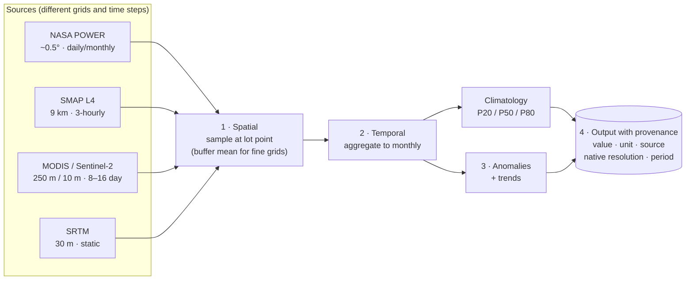

# 03 — Data Sources: Catalog, Selection & Access Plan

> The full resource list comes from the challenge Resources tab (read 2026-11-14). The "Our use" column holds **proposals** for the team to confirm (see `decision-log.md`, D2).
> **The most important filter: our demo site is in the Philippines.** About half the listed resources are **U.S.-only** (USDA/USGS/PRISM/OpenET/LANDFIRE/CoCoRaHS) and won't cover an Iligan farm.

## Verified so far

| Check | Result (2026-11-14) |
|---|---|
| NASA POWER API reachable from our network, **no login** | ✅ HTTP 200 in ~1.8 s. Daily point query at 8.23°N, 124.24°E returned `T2M, T2M_MAX, T2M_MIN, PRECTOTCORR, GWETROOT, GWETTOP, RH2M, ALLSKY_SFC_SW_DWN, WS2M` (sources: MERRA-2, SYN1DEG, POWER) |
| NASA POWER **CORS** (needed for the web build; the Android app's native fetch doesn't need it) | ✅ `access-control-allow-origin: *` |
| NASA POWER **monthly** endpoint, 2001–2025, 7 params | ✅ HTTP 200, ~33 KB, ~1.5 s. ⚠️ Monthly `PRECTOTCORR` is **mm/day** (× days in month); key `YYYY13` = annual value; `-999` = missing. The 2024 sample shows a clear Mar–Apr dry spell at the Iligan cell (0.75–1.2 mm/day; root-zone wetness down to 0.63). |
| `spaceappschallenge.org` via curl/WebFetch | ❌ TLS "untrusted root" on this network. Works in a normal browser. *(GitHub and NASA POWER work fine.)* |
| POWER **monthly temperature** semantics | ⚠️ Compared with the daily endpoint at the Iligan point (2001–2024): monthly `T2M_MAX` equals the **hottest day** of the month and `T2M_MIN` the **coldest day** (0.00 °C difference), about 2 °C away from the mean daily max/min. Monthly `T2M`, `T2M_RANGE`, `RH2M` match the mean of the daily values (≤ 0.01). **Use `T2M ± T2M_RANGE/2` for ET₀** (see `06-architecture.md`). |
| POWER grid-cell caveat | ⚠️ Early Jan 2024 T2M ≈ 23 °C at the Iligan cell, cooler than lowland coastal normals. The ~0.5° × 0.625° MERRA-2 cell likely includes highland terrain (Lanao plateau). **Pick a lowland farm point and/or correct with SRTM elevation, and state this limitation.** Checked 2026-11-14 against the NASA POWER docs: POWER takes T2M "at 2 m above the average elevation of the grid box" and documents no correction to the field's elevation (its `site-elevation` option adjusts pressure only, daily API). The Iligan cell is reported at 741.88 m and its Nov–Mar mean T2M (2001–2025) is 22.64 °C, below rice `opt_low` 25 °C. The provisional demo point is now in the west Lanao del Norte cell (295.93 m, Nov–Mar mean 25.48 °C), so rice no longer gets the "cool" flag there; live lots keep this limitation. No elevation correction is applied: a lapse-rate adjustment has no local source yet (6.5 K/km is the standard-atmosphere convention, not a measurement for this region). |

Example query (reuse in the pipeline):
```
https://power.larc.nasa.gov/api/temporal/daily/point?parameters=T2M,T2M_MAX,T2M_MIN,PRECTOTCORR,GWETROOT,GWETTOP,RH2M,ALLSKY_SFC_SW_DWN,WS2M&community=AG&longitude=124.24&latitude=8.23&start=20010101&end=20251231&format=JSON
```

## Extra API checks (2026-11-14, run from the team network with `curl`)

Quick reachability and CORS tests of sources beyond POWER. "CORS" = browser can call it directly with no proxy.

| Source | Result | Verdict |
|---|---|---|
| **NASA GIBS WMTS** (`gibs.earthdata.nasa.gov/wmts/epsg3857/best/...`) | HTTP 200 for an `IMERG_Precipitation_Rate` tile; `access-control-allow-origin: *`; capabilities XML lists `IMERG_Precipitation_Rate`, `MODIS_Terra_NDVI_8Day`, `MODIS_Terra_L3_NDVI_Monthly`, `VIIRS_*_NDVI_*` | ✅ No auth, CORS open. **Optional map overlay** (imagery only, no numbers for the engine). My one NDVI tile request returned 404, so check the exact layer/date/tile matrix before use. |
| **Open-Meteo Elevation** (`api.open-meteo.com/v1/elevation`) | HTTP 200 in ~1 s, returned 6 m at 8.23°N, 124.24°E (matches OpenTopoData SRTM). One earlier call timed out. | ⚠️ Works. Not a NASA source, so check its terms and cite it. |
| **Open-Meteo ERA5 archive** (`archive-api.open-meteo.com/v1/archive`) | HTTP 200 in ~1 s, `access-control-allow-origin: *`. | ✅ Possible no-account ERA5 cross-check, replacing the CDS account. Check the non-commercial terms first. |
| **OpenTopoData SRTM 30 m** (`api.opentopodata.org/v1/srtm30m`) | HTTP 200 in ~0.4 s, 6 m at the same point, but **no CORS header returned**. | ❌ Don't call from the browser. Use it in `pipeline/` only. See the SRTM notes below. |
| **ISRIC SoilGrids REST** (`rest.isric.org`) | Timed out twice (20-25 s, 0 bytes). | ❌ Unreliable now. Keep the farmer-picks-soil-texture fallback. |
| **AppEEARS** (SMAP, MODIS, ECOSTRESS) | Not tested. Needs an Earthdata login. | Pipeline only, as planned above. |

Elevation caveat: both elevation APIs agree on 6 m, so the Iligan coastal point is low. The POWER cell-vs-lowland caveat above is still unresolved.

**SRTM via Open Topo Data** (from https://www.opentopodata.org/datasets/srtm/, read 2026-11-14):
- **Citation wording (updated 2026-11-14):** the NASA Earthdata catalogue page for SRTMGL1 v003 recommends "NASA JPL. (2013). NASA Shuttle Radar Topography Mission Global 1 arc second [Data set]. NASA Land Processes Distributed Active Archive Center. https://doi.org/10.5067/MEASURES/SRTM/SRTMGL1.003" and says the dataset "is openly shared, without restriction". Acquisition: 2000-02-11 to 2000-02-21. We cite that, and add "served via Open Topo Data". The public API uses SRTM Version 3 at both `srtm30m` and `srtm90m`. Version 3 filled the voids of earlier versions with ASTER GDEM v2, GMTED2010 or NED.
- **Coverage:** −60° to 60° latitude, so the Philippines is covered.
- **Ocean caveat:** ocean areas inside a tile read **0 m**, and points outside any tile return `null`. Sanity-check coastal lot points (handle `null`, and flag a 0 m result near the shoreline).
- **Self-hosting:** possible, but the tiles need an Earthdata login to download. Not worth it for 40 hours.
- **Public API limits** (https://www.opentopodata.org/, read 2026-11-14): max 100 locations per request, 1 call per second, 1000 calls per day. **No terms of use, attribution rule or statement on commercial use is published for the public instance** (checked the site, the API docs and the GitHub README; the software is MIT). CORS is not documented, and our test saw no CORS header, so use it in `pipeline/` only (pre-bake the demo farm).
- **No-data:** by default `null` means either outside the dataset or no data at that cell, and the two cannot be told apart.
- **Precision of what we got:** heights came back in whole metres at every point we tried (bilinear and cubic alike), and the slope over 30, 60 and 90 m spacing differed by a few percent (measured 2026-11-14 at two points). `slope_pct` is therefore stored in whole percent as a rough terrain class. Vertical accuracy is not stated on the pages we could read.
- **Not used for lot area (D31, #107):** `area_ha` stays the flat map area from `turf.area`. Sampling SRTM inside a lot would send the field's shape to Open Topo Data (rule 8), and on slopes under 10% the ground area is less than 1% larger.

## Philippine sources (researched 2026-11-14)

Found by a research pass over PSA, DA-BSWM, PhilRice, PAGASA, NOAA and community hazard archives. "Verified" means the team's `curl` test succeeded today. Everything else is from the research pass and still needs a manual check.

| Source | What | Status | Our use |
|---|---|---|---|
| **PSA OpenSTAT, crop production and area** (`openstat.psa.gov.ph/PXWeb/api/v1/en/DB/2E/CS`) | Palay and corn production (`0012E4EVCP0`) and area harvested (`0022E4EAHC0`) by province, quarterly. Lanao del Norte = Geolocation code `80`. Other tables cover fruit, vegetable, root and industrial crops. | ✅ Verified. CORS `*`. A Lanao del Norte query returned values for Q1 2023 to Q4 2025. | **Enrich, near-Core for "local yield".** Yield = production ÷ area. Cite as "PSA OpenSTAT, Lanao del Norte, 2023-2025". |
| **PSA OpenSTAT, farmgate prices** (`.../DB/2M/FG`) | 11 tables by province. Lanao del Norte is present. | ⚠️ Verified, but **every table ends in 2020** (cutflowers start in 2006, others 1990). | Use only as a labelled historical price, "last available 2020". The quarterly table `0032M4AFN03` (found in the research pass) is not yet checked. |
| **NOAA CPC ONI** (`cpc.ncep.noaa.gov/data/indices/oni.ascii.txt`) | Oceanic Niño Index, monthly, 1950 onward | ✅ Verified, plain text. CORS not tested (the server sent no CORS header on the test request). | Bundle in the pipeline as an El Niño / La Niña context line, cited. |
| **PAGASA El Niño advisories** (`pagasa.dost.gov.ph/climate/el-nino-la-nina/advisories`) | Advisory No. 6 issued 2026-11-03 (per the research pass) | PDF only. | Cite and summarize by hand. Don't fetch in the app. |
| **open-hazards-ph** (`s3.amazonaws.com/open-hazards-ph/lipad/`) | Archived NOAH/LiPAD flood hazard layers for Iligan at 5, 25 and 100 years (10 m) | ✅ File exists (805 KB zip). Files date from 2018. Licence to check before shipping. | Stretch: simplify to a flood-risk class per lot. Label the 2018 vintage. |
| **PhilRice seed database** (`dbmp.philrice.gov.ph/seeds/...`) | Rice variety maturity days and yield | HTML only, unverified by us. | Pre-bake crop-cycle values for rice, with citation. |
| **BSWM Lanao del Norte suitability maps** (`bswm.da.gov.ph/wp-content/uploads/Lanao-del-Norte_SUITABILITY-rice.pdf`) | Rice, fertility, pH and cassava suitability maps (2016 project) | PDF only, no GIS layer found. | Reference or manual digitizing only. |
| **BSWM FertMap** (`nshp.bswm.da.gov.ph/fertmap/`) | Soil pH, N, P, K, texture by barangay | Web app, no API found. | Link out. Don't scrape. |
| **Geofabrik OSM extract** · **ESA WorldCover 10 m** | Roads and land use · land cover | Not tested. ODbL · CC-BY 4.0. | Pre-bake only, with attribution. |

**Pipeline gotchas found in testing (PSA):**
- The PSA API sits behind Cloudflare. Python's default `urllib` user agent got **403**. Set a normal `User-Agent` header.
- Request `"format": "json"` or `"csv"`. The `json-stat2` format returned a single placeholder value (`1.0`) instead of the data.
- With `"format": "csv"`, quarterly, semester and annual periods all return data for Lanao del Norte (annual palay 2024 = 200,017.97 t in the test).

**Gaps (no structured source found):**
- Planting months or crop calendars for Lanao del Norte. Keep default windows labelled as assumptions (rule 3) until one is found.
- Current farmgate prices after 2020. DA price monitoring is PDF-only and Metro Manila-focused.
- Lanao del Norte climate type is reported inconsistently (Type III vs Type IV). Resolve it with the PAGASA map before using it.

**Dead ends:** GeoRiskPH and HazardHunter (login or data agreement), PRiSM detailed data (by request), PAGASA seasonal forecast and normals (PDF or image only), HDX and RKB (not opened).

## Tiering

- **Core**: the MVP can't work without it. Must be reliable and need no auth, or only quick auth.
- **Enrich**: adds Relevance or Validity if time allows; MVP has a fallback without it.
- **Partner**: Space Agency Partner data (its own form field; "highly encouraged").
- **Skip**: not applicable to a Philippine site, or poor value for 40 hours.

## NASA data & resources (from the challenge page)

| Resource | URL | Coverage | What it gives us | Our use | Access / auth |
|---|---|---|---|---|---|
| **NASA POWER** (Agroclimatology) | https://power.larc.nasa.gov/ | Global, ~0.5° | Daily T, Tmax/Tmin, precip, RH, wind, solar, **root-zone & surface soil wetness** (`GWETROOT`/`GWETTOP`); everything needed for FAO-56 ET₀ | **Core**: climate normals, ET₀, water balance, heat-stress days, trends 2001–2025 | REST API, no auth ✅ |
| **SMAP** (soil moisture) | https://www.earthdata.nasa.gov/data/platforms/space-based-platforms/smap | Global, 9 km (L4) | Surface and root-zone soil moisture, 2015→ | **Enrich**: real satellite soil moisture next to the POWER model values; anomaly chart | Earthdata login; easiest as an **AppEEARS point request** (SPL4SMGP / SPL3SMP_E). *Verify products in AppEEARS.* |
| **GPM / IMERG** | https://gpm.nasa.gov/data | Global, 0.1° | Precip rate and accumulation, extreme storms | **Enrich**: rainfall reliability, extreme-rain months (erosion), cross-check with POWER precip | Earthdata login; monthly area-average CSV via **Giovanni**, or Worldview images for the slides |
| **MODIS / VIIRS** (NDVI, ET) | https://lpdaac.usgs.gov/products/ · https://search.earthdata.nasa.gov/ | Global, 250 m–1 km | NDVI/EVI (MOD13Q1), ET (MOD16A2) | **Enrich**: seasonal NDVI curve showing **bare-field periods** and stress | AppEEARS point request (Earthdata login) |
| **Landsat** | https://earthexplorer.usgs.gov/ | Global, 30 m | Reflectance, NDVI, field-scale | **Enrich (slides)**: field-scale image of the demo farm | EarthExplorer (USGS login) |
| **SRTM** (elevation) | https://www.earthdata.nasa.gov/data/instruments/srtm | Global, 30 m | Elevation, slope | **Enrich → near-Core**: slope feeds erosion risk; elevation feeds the temperature correction | AppEEARS area request, or OpenTopography (API key) |
| **ECOSTRESS** | https://ecostress.jpl.nasa.gov/data | Irregular overpasses, 70 m | Land-surface temperature, ET | **Enrich (stretch)**: heat-stress hotspot story | AppEEARS (Earthdata login) |
| **NLDAS / GLDAS** | https://www.earthdata.nasa.gov/ (search "GLDAS") | **GLDAS global**; NLDAS = N. America | Gridded soil moisture, ET, met | **Enrich (alt)**: GLDAS as another soil-moisture/ET series if SMAP is hard to get | Earthdata/Giovanni |
| **GEDI** | https://gedi.umd.edu/data | Global (forests) | Canopy height, biomass | **Skip**: little value for paddy and annual crops | — |
| **GRACE / GRACE-FO** *(named in Objectives, not on Resources tab)* | via Earthdata | Global, coarse | Water-storage trends | **Skip / stretch**: one "long-term water trend" chart at most | Earthdata |

## U.S.-only resources (listed on the page): **Skip for a Philippine site**

| Resource | URL | Why skip |
|---|---|---|
| USDA Ag Data Commons | https://www.nal.usda.gov/services/agdatacommons | U.S. datasets |
| Web Soil Survey (WSS) | https://websoilsurvey.nrcs.usda.gov/app/ | U.S. soils only |
| Cropland Data Layer (CropScape) | https://nassgeodata.gmu.edu/CropScape/ | U.S. only |
| PRISM | https://prism.oregonstate.edu/ | U.S. only |
| SSURGO / STATSGO2 | https://www.nrcs.usda.gov/resources/data-and-reports/soils | U.S. only |
| NAIP | https://naip-usdaonline.hub.arcgis.com/ | U.S. only |
| USGS NLCD | https://www.usgs.gov/centers/eros/science/national-land-cover-database | U.S. only |
| CoCoRaHS | https://www.cocorahs.org/Maps | North America only |
| USGS NWIS | https://waterdata.usgs.gov/nwis | U.S. only |
| USDA AMS Market News | https://www.ams.usda.gov/market-news | U.S. markets |
| USDA NASS QuickStats | https://quickstats.nass.usda.gov/ | U.S. stats |
| OpenET | https://openetdata.org/ | Western U.S. only |
| USFS LANDFIRE | https://www.landfire.gov/ | U.S. only |

> Some of these are worth a sentence in the description, e.g. "the architecture can plug in SSURGO/CDL for U.S. deployments." Don't build anything with them.

## Global non-NASA resources (from the page)

| Resource | URL | Our use |
|---|---|---|
| **FAO GAEZ** (agro-ecological zones) | https://gaez.fao.org/ | **Enrich**: check that candidate crops are climatically and soil-suitable at the site; cite as "evidence" in strategy cards |

## Space Agency Partner resources

| Resource | Agency | URL | Our use |
|---|---|---|---|
| **Copernicus Sentinel-2** | ESA | https://dataspace.copernicus.eu/ | **Partner**: 10 m NDVI image(s) of the demo field across a season, showing bare vs. vegetated periods. Use in the app's "Field view" and the slides. Export manually from the Copernicus Browser. |
| **ERA5 reanalysis** | ECMWF (Copernicus) | https://cds.climate.copernicus.eu/datasets/reanalysis-era5-single-levels?tab=overview | **Partner (optional)**: cross-check POWER temperature and precip; soil temperature. Needs a CDS account. |

## Non-listed sources to consider (verify before relying on them)

| Source | Why | Status |
|---|---|---|
| FAO-56 (Allen et al., 1998) Penman-Monteith and crop coefficients (Kc tables) | Standard method for ET₀ and crop water demand. Gives us a defensible Validity story. | Method is well established. **Copy the Kc values from the FAO-56 tables directly and cite them.** |
| FAO Ecocrop | Crop temperature/rainfall ranges, cycle length | Site availability varies, **check early**. Fallback: FAO-56 plus GAEZ plus extension literature. |
| ISRIC SoilGrids / HWSD v2 (global soil) | Soil texture, organic carbon, pH at the farm point | **Verify the API is up.** Fallback: the farmer picks the soil texture (sand/loam/clay) by hand. |
| Philippine sources: PhilRice, PAGASA, DA/BSWM, PSA OpenSTAT | Local crop calendars, rotation practice, local prices | For "evidence" and "market" inputs. Team to check which are reachable. |

## Proposed data-contract additions (for the Data lead; team to accept before the Sat 13:00 freeze)

Proposals only. They extend the v0 contracts in `06-architecture.md` without changing existing fields, so they can be adopted or dropped independently. Everything is optional (`null` = not available) so the engine must not depend on it.

**1. Local yield from PSA, a new file `mobile/assets/data/psa/yields.json` (pre-baked by `pipeline/`)**
```jsonc
{
  "source": "PSA OpenSTAT, tables 0012E4EVCP0 (production) and 0022E4EAHC0 (area harvested)",
  "retrieved": "2026-11-14",
  "provinces": {
    "80": {                                   // PSA Geolocation code (example: Lanao del Norte)
      "name": "Lanao del Norte",
      "palay": { "year": 2024, "production_t": 200017.97, "area_ha": null, "yield_t_per_ha": null },
      "corn":  { "year": 2024, "production_t": null,      "area_ha": null, "yield_t_per_ha": null }
    }
  }
}
```
- `yield_t_per_ha` = annual production ÷ annual area harvested, computed in the pipeline. Fill the `null`s from the API. Only the palay production figure above was seen in our test.
- Only **palay and corn** were verified. PSA has other tables (fruits, vegetables, root and industrial crops) that were listed but not queried.
- Map a crop to a PSA table through a `psa_group` field on the `crops.json` entry (`"palay"`, `"corn"`, or `null`). Crops with `null` keep the team-estimate yield, labeled as such.
- Feeds the optional `yield_t_per_ha` for the trip-burden calculation (07 §3c). Cite as "PSA OpenSTAT, [province], [year]".

**2. Lot to province: one new optional field on each farm lot**
```jsonc
"province_code": "80"     // PSA Geolocation code, or null. Picked by the farmer from a list (works offline).
```
No verified boundary source exists to detect the province automatically, so the farmer picks it. If the PSA value for that province is missing or `0.00`, fall back to the region value or hide the local-yield line.

**3. Terrain on demo farms and live lots (existing fields `elevation_m` and `slope_pct`)**
- Source: **NASA SRTM v3 (1 arc-second, about 30 m), served via Open Topo Data**. Add a `provenance` entry for each, as for the other fields.
- Handle `null` (point outside any tile) and a **0 m result near the shoreline** (ocean areas inside a tile read 0 m). Flag both in `caveats`.
- Pipeline can call it freely. The **Android app can too** (native `fetch` has no CORS limit), but the **web build can't**: OpenTopoData sent no CORS header in our test. Open-Meteo's elevation endpoint is a possible alternative, but its CORS is **untested** (it timed out twice when we checked; it worked once without a CORS check) and it is a different dataset, so label it separately. Mind the public instance's rate limits.

**4. Climate context, a small new file `mobile/assets/data/context.json`**
```jsonc
{
  "oni": { "season": "ASO", "year": 2026, "anomaly_c": null, "source": "NOAA CPC ONI", "url": "https://www.cpc.ncep.noaa.gov/data/indices/oni.ascii.txt", "retrieved": "" },
  "advisory": { "issuer": "PAGASA", "title": "", "issued": "", "summary_by_hand": "", "url": "" }
}
```
Read the ONI value from the file when baking and **copy it, don't type it from memory**. The PAGASA advisory is PDF only, so summarize it by hand and cite the link. This gives a cited "why now" line. It isn't an engine input.

**5. Which sources work where (for the dev team)**

| Source | Pipeline (Python) | Android (native fetch) | Web build (CORS) |
|---|---|---|---|
| NASA POWER | ✅ | ✅ | ✅ `*` |
| PSA OpenSTAT | ✅ (set a browser `User-Agent`; use `csv` or `json`, not `json-stat2`) | ✅ | ✅ `*` (tested with curl) |
| NASA GIBS tiles | ✅ | ✅ | ✅ `*` |
| Open-Meteo ERA5 archive | ✅ | ✅ | ✅ `*` |
| Open-Meteo elevation | ⚠️ one call timed out, one worked | ⚠️ same | ❓ CORS untested (timed out twice) |
| OpenTopoData SRTM | ✅ | ✅ | ❌ no CORS header |
| NOAA ONI | ✅ | ✅ | ❓ no CORS header seen, so **bake it in** |

"✅ native" is expected from how native `fetch` works, but nobody has run these calls from the Expo app yet. Test one in Expo Go before relying on it.

## Harmonization approach (answers the "common grid" consideration)

The farm is a **single point**. For the MVP we harmonize to **point × month**:
1. **Spatial**: sample every dataset at the farm coordinate. Use the nearest grid cell for coarse grids; for 10–30 m imagery, take the mean over a small buffer (e.g. 100 m) around the point. Record each source's native resolution in the output JSON, because the UI shows it as part of "confidence".
2. **Temporal**: aggregate daily or 8–16-day data to **monthly** values (sum for precip and ET; mean for temperature, soil moisture, NDVI; count for heat-stress days). Build **climatology** from 2001–2025 (POWER), or from the sensor's start year (SMAP 2015→).
3. **Anomalies**: each month's deviation from its climatology. Trends: the last 10 years against the earlier period.
4. Keep the provenance on every derived number: `{value, unit, source, native_resolution, period}`.



## Accounts to create (do this in hour 1, because some requests queue)

- [ ] **NASA Earthdata Login** (free), for AppEEARS, Giovanni, and Earthdata Search. Each person creates their own; no shared passwords.
- [ ] **Submit the AppEEARS point request early** (SMAP L4 root zone, MOD13Q1 NDVI, MOD16A2 ET for the farm point, 2015–2025). Requests can sit in a queue.
- [ ] Copernicus Data Space account (Sentinel-2 browser export).
- [ ] *(Optional)* CDS account for ERA5.
