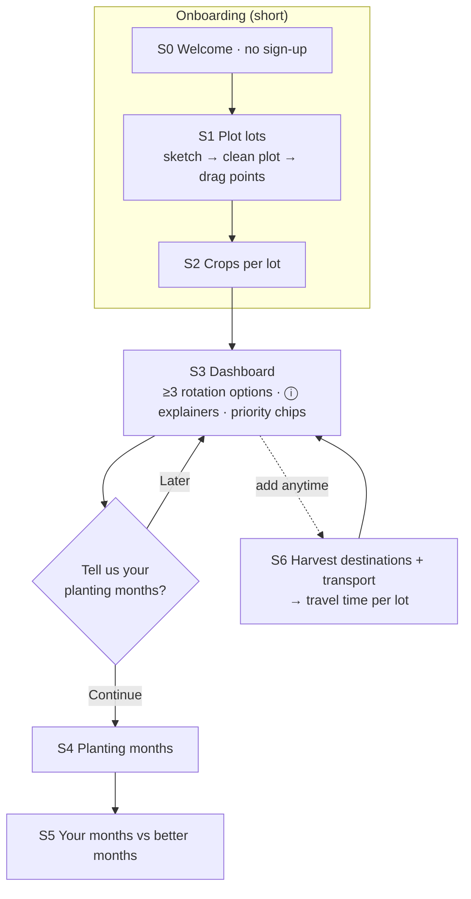

# 05 — MVP Scope, Persona & User Flow

> Built for ~40 hours of hackathon time (Sat 08:00 → Sun 21:00 PHT submission target). Everything below is **proposed**; confirm in `decision-log.md`.

## Persona (demo anchor)

**Mang Rodel** (fictional, adult): a smallholder in **Lanao del Norte**, near Iligan, with **two lots**. **Lot 1** is ~1 ha of rainfed lowland rice; he grows two rice crops a year when rain allows, and the field sits **bare or weedy** for part of the year. **Lot 2** is a small sloping upland lot with corn and some vegetables. He takes his harvest by **motorcycle (habal-habal)** to the town market and sometimes to a rice trader's storage; vegetables can spoil on the long trip. He has a basic Android phone with **patchy mobile data in the field**; he gets signal at home or in the town center. He worries about dry spells hitting his second crop, declining yields, and fertilizer cost. His municipal agricultural technician visits occasionally. **He won't create an account for an app.**

*(Keep him fictional. Use no photos of real people, especially anyone under 18. Any SI-generated illustration needs a visible "SI-generated" watermark.)*

**Secondary user (stretch):** the municipal agricultural technician or a cooperative officer looking at several farms.

## The user flow (team-defined; full screen spec in [11-user-flow.md](11-user-flow.md))

**No login, no account.** Farm data stays on the phone.

- **S0 Welcome:** "Start" (no sign-up); returning users go straight to the dashboard.
- **S1 Plot lots:** sketch each lot with a finger → the app converts it to a clean plot → drag points to adjust. Onboarding draws Lot 1; more lots come from **+ Add lot** on the dashboard (D31). Tap-corners or pin + area as alternatives.
- **S2 Crops per lot:** pick everything planted on each lot (many crops per lot). The NASA data fetch runs in the background. **Onboarding ends here.**
- **S3 Dashboard:** per lot: rain vs water need, soil moisture, crop fit, ≥3 rotation recommendations ("Your crops" on an assumed typical calendar + alternatives), each with Why / Evidence / Benefits / Unknowns / Check locally. Every chart has a "ⓘ What am I looking at?" explainer. Priority chips re-rank the results.
- **S4 Planting months (optional):** per lot, per crop: planting → harvest months; + another season.
- **S5 Side by side:** per crop, YOUR months vs BETTER months, with data; whole-lot calendar: yours vs better timing vs alternative rotation(s).
- **S6 Destinations (add anytime, not in onboarding):** from the dashboard card or Edit farm, pin market / storage / buyer / co-op, pick a transport mode → travel time per lot (farmer confirms) → Market access appears on the dashboard.
- **Always:** offline after onboarding · "supports, doesn't replace your technician" · Learn + Data & limits pages.

## MoSCoW

### Must (the demo fails without these)
- [ ] **No login / no account**; all farm data stored on the device
- [ ] **S1 map onboarding**: **freehand sketch → auto-converted clean plot**, plot points **draggable** (+ add/remove points), tap-corners as a second way, pin + area fallback; **multiple lots** (+ Add lot on the dashboard, D31), rename/delete, live area
- [ ] **S2 multiple crops per lot**
- [ ] **Short onboarding: S0 → S1 lots → S2 crops → dashboard** (nothing else is required before results)
- [ ] **S6 harvest destinations (add anytime, outside onboarding)**: opened from the dashboard card or Edit farm; pin market/storage/buyer/co-op, transport mode per destination, **travel time per lot** (rough offline estimate at minimum) that the **farmer can confirm or correct**; travel time feeds the Market access score and explanations
- [ ] **Live NASA POWER fetch per lot** by the app at onboarding (monthly 2001–2025), cached for offline. Plus **≥1 precomputed demo farm** so the demo works even without a connection.
- [ ] Crop library JSON with **8–12 crops** relevant to the Philippines (season length, Kc stages, temperature range, N-fixing, root depth, rough labor and market notes) **plus a typical local planting calendar per crop**, every parameter **cited**
- [ ] **S3 dashboard** per lot: rain vs water need, soil moisture, crop fit, **≥3 rotation options including "your crops"**, explanation fields, **ⓘ explainer on every chart**
- [ ] **S4 planting months** (optional step) + **S5 side-by-side "your months vs better months"** per crop, with data, plus the whole-lot calendar comparison
- [ ] Persistent disclaimers plus a **Data sources & limitations** page
- [ ] **Android app (APK)**: installs, opens offline from first launch (demo farm bundled), and **dashboard and comparisons work offline** after onboarding (test in airplane mode)
- [ ] **Web build** of the same app at a public URL for judges (hosting: D8)
- [ ] Deployed at a **public URL**; public GitHub repo with README (data used, how it works, Use of SI)

### Should (these noticeably raise the score)
- [ ] **Priority chips** ("save water / build soil / extra income / less work") re-rank recommendations offline *[suggested: covers the challenge's farmer-priorities requirement]*
- [ ] Optional **lot details** (land type, water source, soil feel, with "I don't know" defaults)
- [ ] SRTM slope feeding the erosion-risk score (for sloping lots)
- [ ] **Online road routing** (OSRM, CORS verified) for travel time, with the offline estimate as fallback
- [ ] **Trips needed per harvest** (yield × area ÷ load per trip) and **wet-season road slowdown** in heavy-rain harvest months
- [ ] SMAP root-zone soil moisture (AppEEARS) next to POWER `GWETROOT`, which gives the "satellite vs model" teaching moment
- [ ] Wet-year vs dry-year range (P20/P80) and a confidence badge
- [ ] Learn/glossary page
- [ ] 3-year rotation view (Year 1–3) with the soil-health index trajectory (transparent formula)

### Could (stretch)
- [ ] **Scenario slider**: rainfall −30%…+20%, temperature +0…+2 °C, recomputed on the device
- [ ] MODIS / Sentinel-2 NDVI seasonal curve or image showing bare-field months
- [ ] Regional view: small map of a few barangays/municipalities with a risk color
- [ ] Cebuano UI labels
- [ ] Backup / restore file (since there's no account, clearing browser data loses the farm)
- [ ] "Straighten?" snap of a near-rectangular sketch
- [ ] Transport cost per harvest from a farmer-entered fare
- [ ] SI-written plain-language summary per strategy, **precomputed, reviewed by the team, and labeled "SI-generated"**

### Won't (this weekend)
- User accounts, push notifications, cooperative admin back office, a real ML yield model, GEE pipelines, U.S.-only datasets
- Automatic field-boundary detection from satellite imagery (snapping the sketch to visible field edges): good future work, too heavy for 40 h

## Definition of Done for the demo

1. On a phone, with no login: **sketch** 2 lots, drag a corner to adjust one, add crops to each, and land on the dashboard with real NASA-derived data for each lot (onboarding is only these steps).
2. From the dashboard, **add a market later**, pick a transport mode, confirm the travel time, and see Market access appear and the recommendations re-rank.
3. Enter planting months → see "your months vs better months" side by side for every crop.
4. Go offline: the app still opens, shows both lots, the dashboard, and the comparisons.
5. Every number on screen can be traced to `{source, period, method}` via its ⓘ explainer or the Data page.
6. At least three rotation options are visible per lot, including the farmer's current crops, each with all five explanation fields filled.
7. The README tells a judge in 2 minutes what this is, which NASA data drives it, and how to run it.
