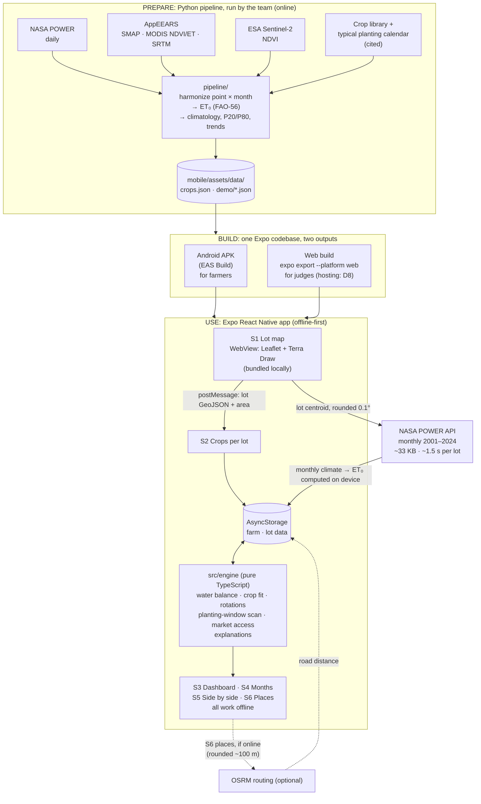
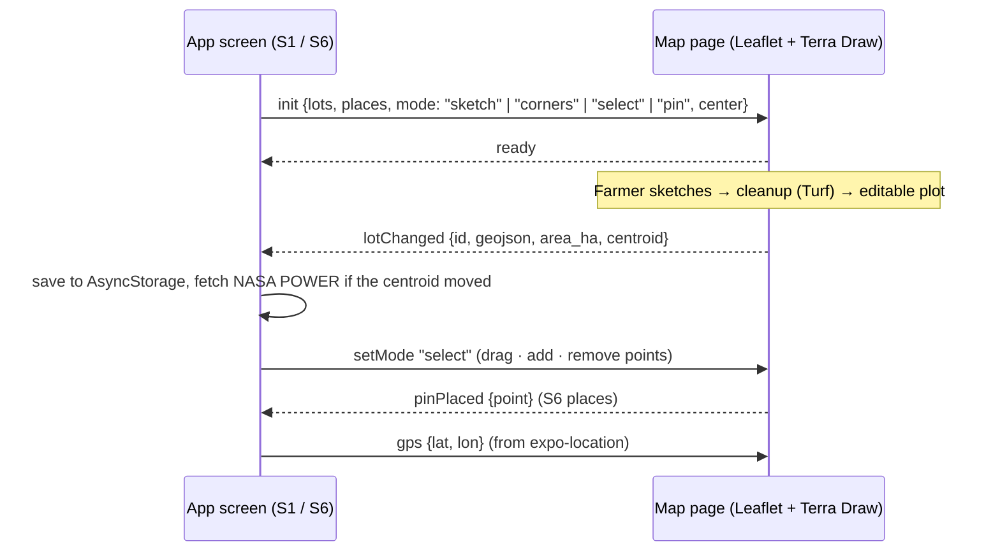
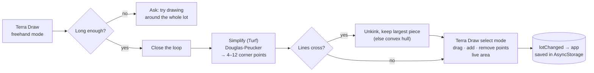

# 06 — Hackathon Architecture (MVP)

> Refines the architecture in `reference/initial-proposal.md`, keeping its principle that **heavy data work happens in the cloud or ahead of time, and decisions run on the device**. What changes: no Earth Engine dependency, **no backend server and no accounts**, the farmer's lots get NASA data **fetched live by the app at onboarding**, and the rotation engine runs **on the device** so it keeps working offline.
> **Team decisions (2026-11-14):** **Expo React Native**, building an **Android app for farmers and a web build for judges** from one codebase (D4) · lot map = **Leaflet + Terra Draw inside a WebView** (D21) · **folder ownership + short PRs** (D22). Hosting for the web build is still open (D8).

## Overview



*Online-only: map tiles, the first NASA data fetch per lot, and optional road routing. The Android app ships its code, crop data, demo farm, and map libraries **inside the APK**, so everything else works offline from the first launch.*

### Live per-lot data fetch (verified 2026-11-14)

- `GET https://power.larc.nasa.gov/api/temporal/monthly/point?parameters=T2M_MAX,T2M_MIN,PRECTOTCORR,GWETROOT,RH2M,WS2M,ALLSKY_SFC_SW_DWN&community=AG&longitude=<lon>&latitude=<lat>&start=2001&end=2024&format=JSON`
- HTTP 200, ~33 KB, ~1.5 s. **Android app:** native `fetch`, so CORS doesn't apply. **Web build:** works too, because POWER sends `access-control-allow-origin: *` (verified).
- ⚠️ **Gotchas:** monthly `PRECTOTCORR` is **mm/day** (multiply by days in month); month key `YYYY13` is the **annual** value (skip it); missing values are `-999`.
- Query point = **lot polygon centroid, rounded to 0.1°** (POWER cells are ~0.5°, so no accuracy is lost and the farmer's exact location is never sent).
- Lots in the **same POWER cell share identical climate data**. Differences between nearby lots come from land type, slope, soil, water source, and crops. Say this in the ⓘ explainer.
- ET₀ is computed **monthly** with FAO-56 Penman-Monteith from monthly means (an accepted FAO-56 use). Daily-based metrics (e.g. count of days > 35 °C) exist only for precomputed demo farms. Live lots use monthly mean Tmax as a proxy.
- If offline at S1: GPS still works (`expo-location`). Save the lot and mark its data **"pending"**; fetch automatically when back online.

## Why this shape (trade-offs)

| Choice | Why | Cost / risk |
|---|---|---|
| **Expo React Native: Android + web** (D4) | Farmers get a real installable app that works offline from the first launch (code and data are inside the APK). Judges get a web URL from the same code. Engine and data code are shared. | Two targets to test. Android builds go through EAS (needs a free Expo account; the cloud queue can take a while). Some libraries behave differently on web. |
| **Lot map = Leaflet + Terra Draw in a WebView** (D21) | Terra Draw has built-in freehand drawing and editable, draggable points. Works in **Expo Go** (no custom dev build). **No Google Maps API key or billing.** The same map page runs on web in an `<iframe>`. | A message bridge between the app and the map page. WebView performance on low-end phones and touch gestures need early testing. |
| **No backend; the app calls NASA POWER directly** per lot + precomputed demo farms | Any lot anywhere works. Nothing to keep alive during judging. No accounts. | Live lots only get POWER data (SMAP/NDVI/slope need auth or queues, so only demo farms get them). Onboarding needs a connection once. |
| **Engine = pure TypeScript** (no React Native imports) | One implementation for Android and web. Unit-testable in Node. Works offline. Priority sliders recompute instantly. | Python and TS must agree on the data contract (`src/types.ts`). Python only prepares data. |
| **NASA POWER as backbone** | Verified working without auth. Has every input for FAO-56 ET₀ plus root-zone wetness. 2001→present. | ~0.5° resolution. Point and grid caveats must be shown (see 03). |
| **AppEEARS for SMAP/MODIS/SRTM** | One tool, point CSV output, Earthdata login only | Requests queue, so **submit them first thing**. MVP doesn't depend on them. |
| **No GEE** | Removes account-approval and learning-curve risk | Loses easy raster maps. The regional map is a stretch anyway. |

## Stack

| Layer | Pick | Notes |
|---|---|---|
| Pipeline | Python 3.11+, `requests`, `pandas`, `numpy` (optional `pymannkendall`, `scikit-learn`) | Scripts plus one exploratory notebook for charts and sanity checks |
| App framework | **Expo (React Native) + TypeScript + expo-router** | Targets: Android + web. Day-to-day testing on phones with **Expo Go** (scan the QR code). |
| Lot map | **Leaflet + Terra Draw** in `react-native-webview` (Android) / `<iframe>` (web), plus **Turf.js** (simplify, unkink, area, centroid) | Map page source in `mobile/map-src/`, bundled into **one local HTML file** (no CDN) so drawing works offline. Satellite basemap: **check the tile provider's terms and attribution** (D25). Offline: lot shapes on a plain background, no tiles. Don't bulk-cache tiles. |
| Storage | **AsyncStorage** (`@react-native-async-storage/async-storage`) | Keys: `farm` (lots, crops, months, places, priorities), `lotdata:<lotId>`. Uses `localStorage` on web. Data is small (a few KB per lot). |
| Location | `expo-location` | GPS "Find me". Works without signal. Coordinates are sent into the map page. |
| Charts | **To decide in hour 1 (D30):** a `react-native-svg`-based library that renders on **both Android and web** (candidates: react-native-gifted-charts, Victory). Fallback: draw the few simple charts directly with `react-native-svg`. | Charts needed: 12-month bars + line + shaded stress window; small multiples on Compare |
| Android build | **EAS Build** (`eas build -p android --profile preview`) → APK | Needs a free Expo account (D29). **Do a first test build on Saturday evening** so build problems surface early. |
| Web build | `npx expo export --platform web` → static `dist/` | Hosting still open (D8). Must be public with no login by Sunday. |

## Map WebView bridge



- Message types live in **`mobile/src/map/bridge.ts`** and are shared by both sides. Treat them as part of the data contract.
- Android: `MapView.native.tsx` → `react-native-webview` with `source={{ html }}`; messages via `postMessage` / `onMessage`.
- Web: `MapView.web.tsx` → `<iframe srcDoc={html}>`; messages via `window.postMessage`.

## Repository layout and folder ownership (D22)

```
agrosprout/
├── .claude/                     Claude Code project config (agents, CLAUDE.md)
├── docs/                        Planning & docs ............................ Story
├── pipeline/                    Python data prep ........................... Data
│   ├── fetch_power.py · et0.py · build_demo.py · demo_farms.yaml
│   └── raw/                     (gitignored) downloaded data
├── mobile/                      Expo app (Android + web)
│   ├── app/                     expo-router screens .......................... Frontend
│   │                            index (welcome) · lots · crops · dashboard · months · compare · places
│   ├── map-src/                 Leaflet + Terra Draw page → bundled map.html .. Frontend
│   ├── assets/data/             generated crops.json, demo/*.json ............ Data
│   └── src/
│       ├── engine/              pure TS: water balance, fit, rotations, scan,
│       │                        access, explain, params.ts ................... Engine
│       ├── data/                power.ts, et0.ts, routing.ts, store.ts ....... Data
│       ├── map/                 MapView.native.tsx, MapView.web.tsx, bridge.ts  Frontend
│       ├── components/          charts, cards, ⓘ explainers .................. Frontend
│       └── types.ts             shared data contracts ...... Engine + Data (PR only)
├── README.md                    judge-facing: what, why, NASA data, how it works, Use of SI, run instructions
└── THIRD_PARTY.md               every dataset, library, image, and reference used
```

Workflow rules are in [08](08-hackathon-schedule.md#repo-workflow-d22).

## Data contracts (v0, proposed; freeze by Sat 13:00 in `mobile/src/types.ts`)

`farm` (AsyncStorage key `farm`, on the device only)
```jsonc
{
  "version": 1,
  "lots": [
    {
      "id": "lot-1", "name": "Lot 1",
      "geometry": { "type": "Polygon", "coordinates": [[[124.2, 8.2], "..."]] },  // GeoJSON
      "area_ha": 1.02, "centroid": [124.2, 8.2],
      "details": { "land_type": "lowland|upland|sloping|unknown", "water": "rain|some|full|unknown", "soil": "sandy|loamy|clayey|unknown" },
      "crops": [
        { "crop_id": "rice",     "seasons": [ { "plant_month": 6, "harvest_month": 9 }, { "plant_month": 11, "harvest_month": 2 } ] },
        { "crop_id": "mungbean", "seasons": [] }          // empty = months not given yet → use typical calendar (assumed)
      ],
      "data_status": "ready|pending|error", "data_ref": "lotdata:lot-1",
      "travel": [                                   // one per destination, computed when the farmer adds a place (S6)
        { "destination_id": "dest-1", "distance_km": 18.8, "minutes": 70,
          "source": "farmer|route|estimate", "route_profile": "car|bike|foot|null" }
      ]
    }
  ],
  "destinations": [
    { "id": "dest-1", "name": "Poblacion market", "type": "market|storage|buyer|coop",
      "point": [124.24, 8.23], "mode": "walk|carabao|bicycle|motorcycle|tricycle|jeepney|truck",
      "load_kg_per_trip": null, "fare_one_way": null }   // optional, null = "I don't know"
  ],
  "priorities": { "water": 50, "soil": 50, "income": 50, "labor": 50 }
}
```

`lotdata:<lotId>` (computed on the device from the live POWER response) and `demo/<farm>.json` (precomputed) share **the same shape**:
```jsonc
{
  "id": "lanao-norte-demo-1",
  "name": "Demo farm — Lanao del Norte (lowland rice)",
  "lat": 0.0, "lon": 0.0,            // fill in the chosen lowland point (D1)
  "elevation_m": 0,                  // SRTM
  "slope_pct": 0,                    // SRTM-derived
  "period": "2001-2025",
  "monthly": {                       // 12 values each, Jan..Dec
    "precip_mm":       { "p50": [], "p20": [], "p80": [] },
    "et0_mm":          [],
    "tmax_c":          [],  "tmin_c": [],
    "heat_days_gt35":  [],
    "heavy_rain_days_gt50mm": [],
    "rootzone_wetness": [],          // POWER GWETROOT (0–1)
    "smap_rootzone_m3m3": null       // optional, AppEEARS
  },
  "trends": { "annual_precip_mm_per_decade": 0, "dry_season_deficit_mm_per_decade": 0, "tmax_c_per_decade": 0, "method": "Sen's slope / Mann-Kendall", "p_values": {} },
  "provenance": [ { "field": "precip_mm", "source": "NASA POWER PRECTOTCORR", "native_res": "0.5° x 0.625°", "retrieved": "2026-11-14" } ],
  "caveats": [ "Grid cell includes highland terrain; temperatures may read cooler than at the field." ]
}
```

`crops.json` (one entry per crop, every numeric field cited)
```jsonc
{ "id": "mungbean", "name": "Mungbean", "local_name": "Balatong", "family": "Fabaceae",
  "season_days": 70, "stages_days": [15, 20, 25, 10], "kc": [0.4, 1.05, 0.6],
  "root_depth_m": 0.6, "temp_c": { "min": 0, "opt_low": 0, "opt_high": 0, "max": 0 },
  "waterlogging_tolerance": "low", "drought_tolerance": "medium", "n_fixing": true,
  "labor": "low", "market": "medium", "cover_value": "medium",
  "perishability": "low", "storable_if_dried": true,
  "typical_calendar": [ { "plant_month": 0, "harvest_month": 0 } ],
  "sources": ["FAO-56 Table 11/12", "Ecocrop", "PhilRice/DA guide (TBD)"] }
```
*(The numbers above are **placeholders showing the shape**. The data lead fills in real cited values.)*

### Freehand sketch → plot (S1, team-defined)

Runs inside the map page when the finger lifts (no network needed):



1. **Capture**: Terra Draw **freehand mode**. Disable Leaflet one-finger dragging while drawing and re-enable it afterward. **Hour 1: confirm** how Terra Draw handles touch and two-finger pan/zoom while in freehand mode.
2. **Close**: Terra Draw closes the freehand polygon. Discard tiny strokes (e.g. < 6 points or < ~100 m²) with "Try drawing around the whole lot".
3. **Simplify**: `turf.simplify` (Douglas-Peucker) with a tolerance scaled to the sketch size or zoom, so a shaky trace becomes **~4–12 corner points**. Cap at ~20.
4. **Clean**: if the line crosses itself, `turf.unkinkPolygon` and keep the largest piece. If the result is still invalid, fall back to the convex hull and tell the farmer to adjust it.
5. **[Could] Straighten**: if the shape fits its minimum rotated rectangle closely, offer "Straighten?"
6. **Edit**: replace the feature with the cleaned polygon in Terra Draw **select mode**, with points draggable, midpoints to add points, and deletable points. **Hour 1: verify the exact select-mode flags in the Terra Draw docs.** Use big touch handles (≥ 44 px), live area via `turf.area`, and Undo/Redo.
7. **Save**: send `lotChanged` to the app → AsyncStorage. Refetch NASA data and travel times **only if the centroid moved meaningfully** (e.g. > 0.05°, or > 100 m for routing).

Tap-corners = Terra Draw **polygon mode**, followed by the same step 6. Unit-test steps 3–4 with recorded sample strokes (pure functions in `map-src/cleanup.ts`).

### Travel-time service (optional, online; verified 2026-11-14)

- OSRM-compatible routing: `https://routing.openstreetmap.de/routed-{car|bike|foot}/route/v1/driving/{lon1},{lat1};{lon2},{lat2}?overview=false` (FOSSGIS) or `https://router.project-osrm.org/route/v1/driving/...` (car only).
- Both returned HTTP 200 in ~0.8–1.4 s from our network, with `Access-Control-Allow-Origin: *`, so the web build works too. **These are free community demo servers for light use**: one request per lot × destination, cached, no bulk use. Show "Routing © OpenStreetMap contributors". **Read each server's usage policy before relying on it.**
- Coordinates sent for routing are rounded to **3 decimals (~100 m)**. That's more precise than the 0.1° used for POWER, because roads need it. Mention it in the privacy line.
- If routing fails or the phone is offline: fall back to the rough estimate (07 §3c) and ask the farmer to confirm.
- Implementation: `mobile/src/data/routing.ts` + `mobile/src/engine/access.ts`.

## Offline behavior checklist (Android app)

- [ ] Crop library, demo farm, and the bundled map page ship **inside the APK**; the app opens and shows the demo farm in airplane mode on first launch
- [ ] Per-lot data saved to AsyncStorage as soon as it's fetched; the dashboard reads **only** from storage
- [ ] "Offline" badge plus "Data last updated <date>"; lots with `pending` data show "will update when online"
- [ ] Lots, crops, months, and places persist across app restarts
- [ ] After onboarding, nothing in S3–S6 needs the network (routing upgrades quietly when back online)
- [ ] Tested on a real low-end Android phone in airplane mode

*The web build is for judges and assumes a connection. Offline support there is out of scope.*

## Security / privacy notes

- **No login, no accounts, no server-side storage.** Lots, crops, and destinations stay on the device. Outbound calls with location data: the NASA POWER request (**lot centroid rounded to 0.1°**) and, if online, the routing request (**lot centroid + destination rounded to ~100 m**). Nothing else.
- With no account there's no cloud backup: uninstalling the app or clearing its data (or browser data, on web) erases the farm. (Could: export/import a backup file.)
- No API keys in the app. AppEEARS and Earthdata are used only by the team, offline in the pipeline. **Never commit `.netrc`, tokens, or Expo/EAS credentials.**
