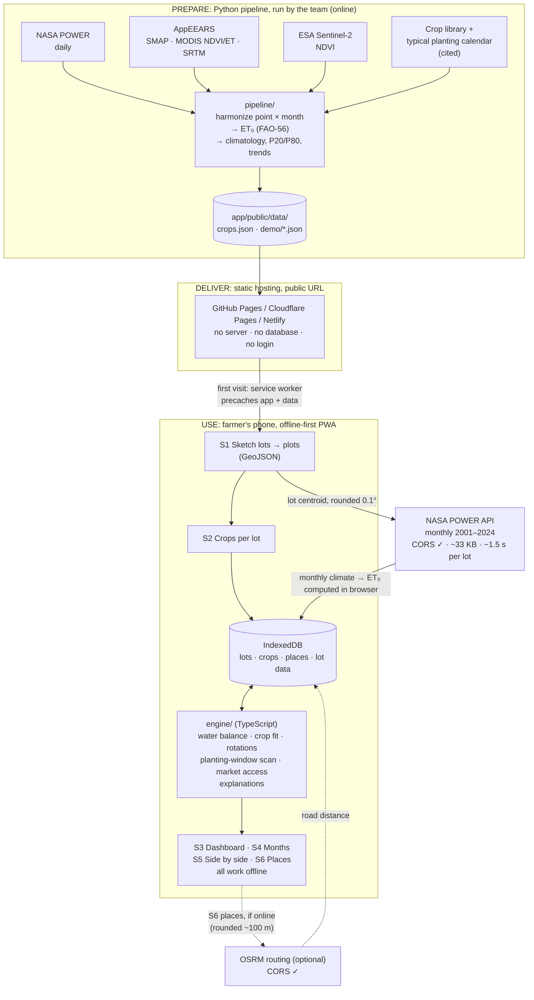
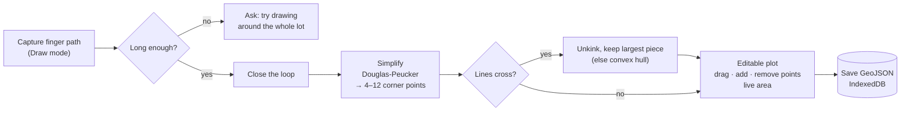

# 06 — Hackathon Architecture (MVP)

> Refines the architecture in `reference/initial-proposal.md`, keeping its principle that **heavy data work happens in the cloud or ahead of time, and decisions run on the device**. What changes: no Earth Engine dependency, **no backend server and no accounts**, the farmer's lots get NASA data **fetched live from the browser at onboarding**, and the rotation engine runs **in the browser** so it keeps working offline.

## Overview



*Online-only: map tiles, the first NASA data fetch per lot, and optional road routing. Everything else runs offline.*

### Live per-lot data fetch (verified 2026-11-14)

- `GET https://power.larc.nasa.gov/api/temporal/monthly/point?parameters=T2M_MAX,T2M_MIN,PRECTOTCORR,GWETROOT,RH2M,WS2M,ALLSKY_SFC_SW_DWN&community=AG&longitude=<lon>&latitude=<lat>&start=2001&end=2024&format=JSON`
- Returns **HTTP 200 with `access-control-allow-origin: *`**, so it can be called straight from the browser with no proxy. ~33 KB, ~1.5 s.
- ⚠️ **Gotchas:** monthly `PRECTOTCORR` is **mm/day** (multiply by days in month); month key `YYYY13` is the **annual** value (skip it); missing values are `-999`.
- Query point = **lot polygon centroid, rounded to 0.1°** (POWER cells are ~0.5°, so no accuracy is lost and the farmer's exact location is never sent).
- Lots in the **same POWER cell share identical climate data**. Differences between nearby lots come from land type, slope, soil, water source, and crops. Say this in the ⓘ explainer.
- ET₀ is computed **monthly** with FAO-56 Penman-Monteith from monthly means (an accepted FAO-56 use). Daily-based metrics (e.g. count of days > 35 °C) exist only for precomputed demo farms. Live lots use monthly mean Tmax as a proxy.
- If offline at S1: GPS still works. Save the lot and mark its data **"pending"**; fetch automatically when back online.

## Why this shape (trade-offs)

| Choice | Why | Cost / risk |
|---|---|---|
| **No backend; browser calls NASA POWER directly** for each lot + precomputed demo farms | Any lot anywhere works (the team's map onboarding needs this). Nothing to keep alive during judging. No accounts. Free hosting. | Live lots only get POWER data (SMAP/NDVI/slope need auth or queues, so only demo farms get them). Onboarding needs a connection once. |
| **Engine in TypeScript, in the browser** | One implementation. Works offline. Priority and scenario sliders recompute instantly. | Python and TS must agree on the data contract. Python only prepares data and doesn't duplicate the scoring logic. |
| **NASA POWER as backbone** | Verified working without auth. Has every input for FAO-56 ET₀ plus root-zone wetness. 2001→present. | ~0.5° resolution. Point and grid caveats must be shown (see 03). |
| **AppEEARS for SMAP/MODIS/SRTM** | One tool, point CSV output, Earthdata login only | Requests queue, so **submit them first thing**. MVP doesn't depend on them. |
| **No GEE** | Removes account-approval and learning-curve risk | Loses easy raster maps. The regional map is a stretch anyway. |

## Proposed stack (confirm in decision log, D4)

| Layer | Pick | Notes |
|---|---|---|
| Pipeline | Python 3.11+, `requests`, `pandas`, `numpy` (optional `pymannkendall`, `scikit-learn`) | Scripts plus one exploratory notebook for charts and sanity checks |
| App | React + Vite + TypeScript | The initial plan allowed React or Vue. Pick whichever the frontend lead is fastest in. |
| PWA | `vite-plugin-pwa` (Workbox) | Precache the app shell **and** `data/*.json`. Test offline in DevTools. |
| Charts | Chart.js (react-chartjs-2) or Recharts | Water-balance bars plus lines with a shaded stress window; small multiples on Compare |
| Map + lot drawing | **Leaflet + Leaflet-Geoman** (free edition: tap-corners drawing + vertex editing/dragging) + **custom freehand capture** + **Turf.js** (simplify, unkink, area, centroid). Alternative to evaluate: Leaflet.FreeDraw. Check whether Geoman's freehand mode is Pro-only before planning around it. | Satellite basemap for onboarding. **Check the tile provider's terms and attribution** (e.g. Esri World Imagery, EOX Sentinel-2 cloudless). Offline: draw the lot polygons as plain vector shapes, no tiles. Don't bulk-cache tiles. |
| Storage | **IndexedDB** via `idb-keyval` or Dexie | Lots (GeoJSON), crops per lot, planting months, lot details, priority weights, cached lot data. No server copy. |
| Hosting | GitHub Pages via Actions (or Cloudflare Pages) | Must be public with no login |

## Repository layout (proposed)

```
agrosprout/
├── .claude/                 Claude Code project config (agents, CLAUDE.md)
├── docs/                    Planning & documentation (this folder)
├── pipeline/                Python data prep
│   ├── fetch_power.py       NASA POWER daily → raw/power_<site>.json
│   ├── et0.py               FAO-56 Penman-Monteith daily ET₀
│   ├── build_demo.py        harmonize → monthly climatology, P20/P80, trends, provenance
│   ├── demo_farms.yaml      demo farm coordinates + metadata
│   └── raw/                 (gitignored) downloaded data
├── app/
│   ├── public/data/         generated: demo/<farm>.json, crops.json  (committed)
│   └── src/
│       ├── data/            power.ts (live fetch + parse), et0.ts (FAO-56 monthly), store.ts (IndexedDB)
│       ├── engine/          water balance, fit, rotations, planting-window scan, explanations, params.ts
│       ├── screens/         Welcome, Lots(map), Crops, Dashboard, Months, Compare
│       └── components/
├── README.md                judge-facing: what, why, NASA data, how it works, Use of SI, run instructions
└── THIRD_PARTY.md           every dataset, library, image, and reference used
```

## Data contracts (v0, proposed; freeze by Sat 13:00)

`farm` (IndexedDB, on the device only)
```jsonc
{
  "version": 1,
  "lots": [
    {
      "id": "lot-1", "name": "Lot 1",
      "geometry": { "type": "Polygon", "coordinates": [[[124.2, 8.2], "..."]] },  // GeoJSON
      "area_ha": 1.02, "centroid": [124.2, 8.2],
      "details": { "land_type": "lowland|upland|sloping|unknown", "water": "rain|some|full|unknown", "soil": "sandy|loamy|clayey|unknown" },
      "crops": [
        { "crop_id": "rice",     "seasons": [ { "plant_month": 6, "harvest_month": 9 }, { "plant_month": 11, "harvest_month": 2 } ] },
        { "crop_id": "mungbean", "seasons": [] }          // empty = months not given yet → use typical calendar (assumed)
      ],
      "data_status": "ready|pending|error", "data_ref": "lot-data/lot-1",
      "travel": [                                   // one per destination, computed when the farmer adds a place (S6)
        { "destination_id": "dest-1", "distance_km": 18.8, "minutes": 70,
          "source": "farmer|route|estimate", "route_profile": "car|bike|foot|null" }
      ]
    }
  ],
  "destinations": [
    { "id": "dest-1", "name": "Poblacion market", "type": "market|storage|buyer|coop",
      "point": [124.24, 8.23], "mode": "walk|carabao|bicycle|motorcycle|tricycle|jeepney|truck",
      "load_kg_per_trip": null, "fare_one_way": null }   // optional, null = "I don't know"
  ],
  "priorities": { "water": 50, "soil": 50, "income": 50, "labor": 50 }
}
```

### Freehand sketch → plot (S1, team-defined)

Pipeline, run on the device when the finger lifts (no network needed):



1. **Capture**: in Draw mode, disable one-finger map panning; record pointer positions → lat/lng (keep two-finger pan/zoom).
2. **Close**: connect the last point to the first. Discard strokes that are too short or tiny (e.g. < 6 points or < ~100 m²) with "Try drawing around the whole lot".
3. **Simplify**: `turf.simplify` (Douglas-Peucker) with a tolerance scaled to the sketch size or zoom, so a shaky trace becomes **~4–12 corner points**. Cap at ~20.
4. **Clean**: if the line crosses itself, `turf.unkinkPolygon` and keep the largest piece. If the result is still invalid, fall back to the convex hull and tell the farmer to adjust it.
5. **[Could] Straighten**: if the shape fits its minimum rotated rectangle closely, offer "Straighten?"
6. **Hand off to editing**: create the polygon as an editable Geoman layer with **draggable vertices** (large touch handles ≥ 44 px), midpoint "+" handles to add points, long-press to delete, live area via `turf.area`, and Undo/Redo stack.
7. **Save** as GeoJSON in IndexedDB; recompute centroid → refetch NASA data and travel times **only if the centroid moved meaningfully** (e.g. > 0.05°, or > 100 m for routing).

Implementation: `app/src/map/freehand.ts` (capture + simplify + clean) and `app/src/map/editPlot.ts` (Geoman edit wiring). Unit-test step 3–4 with recorded sample strokes.

### Travel-time service (optional, online; verified 2026-11-14)

- OSRM-compatible routing: `https://routing.openstreetmap.de/routed-{car|bike|foot}/route/v1/driving/{lon1},{lat1};{lon2},{lat2}?overview=false` (FOSSGIS) or `https://router.project-osrm.org/route/v1/driving/...` (car only).
- Both returned **HTTP 200 with `Access-Control-Allow-Origin: *`** in ~0.8–1.4 s from our network. **These are free community demo servers for light use**: one request per lot × destination at onboarding, cached, no bulk use. Show "Routing © OpenStreetMap contributors". **Read each server's usage policy before relying on it.**
- Coordinates sent for routing are rounded to **3 decimals (~100 m)**. That's more precise than the 0.1° used for POWER, because roads need it. Mention it in the privacy line.
- If routing fails or the phone is offline: fall back to the rough estimate (07 §3c) and ask the farmer to confirm.
- Implementation: `app/src/data/routing.ts` + `app/src/engine/access.ts`.

`lot-data/<lotId>` (computed in the browser from the live POWER response) and `demo/<farm>.json` (precomputed) share **the same shape**:
```jsonc
{
  "id": "lanao-norte-demo-1",
  "name": "Demo farm — Lanao del Norte (lowland rice)",
  "lat": 0.0, "lon": 0.0,            // fill in the chosen lowland point
  "elevation_m": 0,                  // SRTM
  "slope_pct": 0,                    // SRTM-derived
  "period": "2001-2025",
  "monthly": {                       // 12 values each, Jan..Dec
    "precip_mm":       { "p50": [], "p20": [], "p80": [] },
    "et0_mm":          [],
    "tmax_c":          [],  "tmin_c": [],
    "heat_days_gt35":  [],
    "heavy_rain_days_gt50mm": [],
    "rootzone_wetness": [],          // POWER GWETROOT (0–1)
    "smap_rootzone_m3m3": null       // optional, AppEEARS
  },
  "trends": { "annual_precip_mm_per_decade": 0, "dry_season_deficit_mm_per_decade": 0, "tmax_c_per_decade": 0, "method": "Sen's slope / Mann-Kendall", "p_values": {} },
  "provenance": [ { "field": "precip_mm", "source": "NASA POWER PRECTOTCORR", "native_res": "0.5° x 0.625°", "retrieved": "2026-11-14" } ],
  "caveats": [ "Grid cell includes highland terrain; temperatures may read cooler than at the field." ]
}
```

`crops.json` (one entry per crop, every numeric field cited)
```jsonc
{ "id": "mungbean", "name": "Mungbean", "local_name": "Balatong", "family": "Fabaceae",
  "season_days": 70, "stages_days": [15, 20, 25, 10], "kc": [0.4, 1.05, 0.6],
  "root_depth_m": 0.6, "temp_c": { "min": 0, "opt_low": 0, "opt_high": 0, "max": 0 },
  "waterlogging_tolerance": "low", "drought_tolerance": "medium", "n_fixing": true,
  "labor": "low", "market": "medium", "cover_value": "medium",
  "sources": ["FAO-56 Table 11/12", "Ecocrop", "PhilRice/DA guide (TBD)"] }
```
*(The numbers above are **placeholders showing the shape**. The data lead fills in real cited values.)*

## Offline behavior checklist

- [ ] App shell, fonts, icons, `crops.json`, and demo farm JSON precached on first load
- [ ] Per-lot data saved to IndexedDB as soon as it's fetched; dashboard reads **only** from IndexedDB
- [ ] "Offline" badge plus "Data last updated <date>"; lots with `pending` data show "will update when online"
- [ ] Lots, crops, and months persist across reloads and app restarts
- [ ] After onboarding, nothing in S3–S5 calls the network
- [ ] Lighthouse PWA/installability passes. Test on a real Android phone in airplane mode.

## Security / privacy notes

- **No login, no accounts, no server-side storage.** Lots, crops, and destinations stay on the device. Outbound calls with location data: the NASA POWER request (**lot centroid rounded to 0.1°**) and, if online, the routing request (**lot centroid + destination rounded to ~100 m**). Nothing else.
- With no account there's no cloud backup: clearing browser data erases the farm. (Could: export/import a backup file.)
- No API keys in the client. AppEEARS and Earthdata are used only by the team, offline in the pipeline. **Never commit `.netrc` or tokens.** Add them to `.gitignore` before the first commit.
