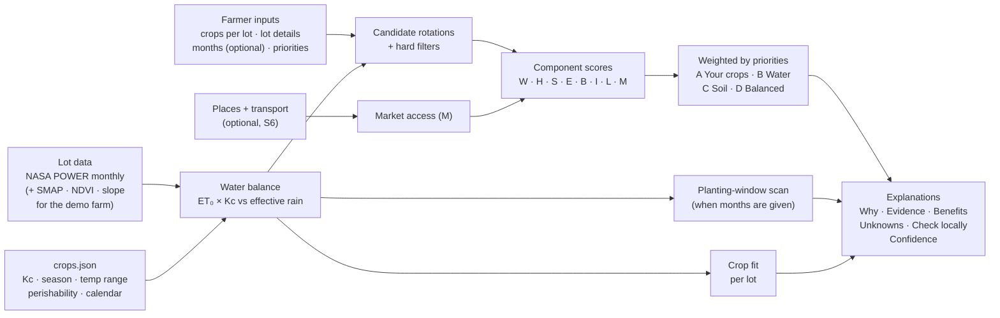
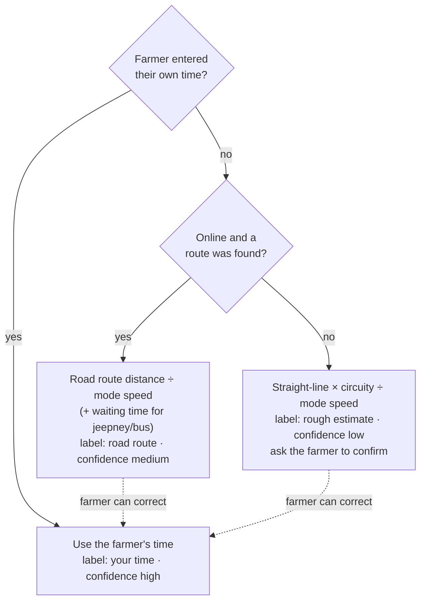

# 07 — Rotation Engine Specification (v0)

> Goal: a **transparent, explainable** engine that turns NASA-derived lot data plus crop characteristics plus farmer inputs into (1) **crop fit** per lot, (2) **≥3 comparable rotation strategies (including the farmer's current crops)**, and (3) a **"your months vs better months"** planting-window comparison. Every formula here is simple on purpose. **Validity comes from traceability, not complexity.**
> Implemented in pure TypeScript (`mobile/src/engine/`, no React Native imports), running **per lot** on the device (Android app and web build). Python only prepares crop data and demo farms ([06](06-architecture.md)). UI flow: [11](11-user-flow.md).

## Engine data flow

## Two stages (matching the team's onboarding flow)

| Stage | Farmer has given | Engine outputs | Screen |
|---|---|---|---|
| **1** | Lots + crops per lot (no months) | Crop fit per lot; rotation options where "Your crops" uses the **typical local planting calendar (labeled assumed)** | S3 Dashboard |
| **2** | + actual planting/harvest months per crop | Planting-window scan (**your months vs better months**) per crop; rotation comparison rebuilt on the **actual** calendar | S5 Side by side |

## 1. Inputs (per lot)

| Input | From | Notes |
|---|---|---|
| Monthly P (p20/p50/p80), ET₀, Tmax/Tmin, root-zone wetness | `lot-data/<lotId>` (live NASA POWER monthly 2001–2025) or `demo/<farm>.json` | Same shape for both. Demo farms also carry daily-derived heat days, heavy-rain days, SMAP, NDVI, slope. |
| Slope / land type | Demo: SRTM. Live lots: farmer's "lowland / upland / sloping" answer | Erosion factor; "unknown" falls back to a moderate default and lowers confidence |
| Soil feel → total available water (TAW) | Farmer: sandy / loamy / clayey / unknown | Use FAO-56 typical ranges, cited |
| Water source | Farmer: rain only / some irrigation / full | Some = supplemental mm/month |
| Crops on the lot | S2 (many per lot) | Defines "Your crops" = **Strategy A** |
| Planting months (optional) | S4: per crop, 1+ seasons of (plant month → harvest month) | Missing → **typical local calendar** from `crops.json`, labeled *assumed* |
| Harvest destinations + transport (optional, added after onboarding) | S6: destination pins (market / storage / buyer / co-op), mode per destination, travel time per lot (farmer > road route > estimate), optional load and fare | Drives the **Market access (M)** score and transport explanations (§3c) |
| Priorities | Chips/sliders (0–100): save water, build soil, extra income, less work | Normalized weights; defaults are all equal |
| Crop library | `crops.json` | 8–12 crops; every number cited; includes a typical local planting window per crop |

**Candidate crops for the Lanao del Norte demo (team to confirm locally):** lowland rice, corn, mungbean, peanut, soybean, cowpea/string bean, sweet potato, sorghum, one vegetable (e.g. eggplant), and a green manure / cover crop (e.g. *Sesbania*). Cross-check suitability against FAO GAEZ.

## 2. Water balance (per crop × month)

Following FAO-56 (Allen et al., 1998):

- **ET₀** (mm/month): FAO-56 Penman-Monteith from **monthly mean** Tmax, Tmin, RH2M, WS2M, ALLSKY_SFC_SW_DWN, and site elevation. The same method runs on the device for live lots (`mobile/src/data/et0.ts`) and in the pipeline for the demo farm (`pipeline/et0.py`), and both pass the same FAO-56 Chapter 4 Example 17 test. *Why monthly in the pipeline too:* a check at the Iligan demo point (NASA POWER 2001–2024, 2026-11-14) found monthly-mean ET₀ within about 1.1% of summing daily ET₀ in every month, and 1,245 vs 1,243 mm over the year, so a daily sum adds code and a larger download for no meaningful gain. One point in a humid tropical area, so re-check if a much drier site is added. Daily POWER data is still used for the daily-only metrics (heat-stress days, heavy-rain days).
- **ETc** = Kc(stage) × ET₀, with Kc interpolated across ini → dev → mid → late using the stage lengths.
- **Effective rain** Peff: the FAO/AGLW monthly rule (Brouwer & Heibloem 1986): `Peff = 0.8P − 25` if P > 75 mm, else `max(0, 0.6P − 10)`. *(Cite it; it's simple, standard, and explainable.)*
- **Rice adjustment**: ponded rice also loses water to seepage, percolation, and land preparation. Add a cited per-month allowance (parameter `rice_extra_mm`). Ask a local expert for typical values.
- **Deficit**: `D_m = max(0, ETc_m − Peff_m − Irr_m)`.
- **Water stress index (WSI)** for a crop instance = Σ D / Σ ETc (0 = no stress, 1 = fully unmet). For ponded rice the allowance is part of the water need (need = ETc + allowance, D = max(0, need − Peff − Irr)), so WSI = Σ D / Σ need and stays within 0–1 (`mobile/src/engine/waterBalance.ts`, #23).
- **Stress window** (chart shading) = months where `D_m > 0.25 × ETc_m`.
- **Dry-year / wet-year**: repeat with P20 and P80 to get a range.

## 3. Generating candidate rotations

A rotation is a 12-month cycle of `(crop, start_month)` slots, repeated for the 3-year view.

1. Enumerate sequences of 1–3 crops whose durations plus a 10–14 day turnaround between crops fit in 12 months, with start months 1–12.
2. **Hard filters (reject):** any month outside the crop's [Tmin, Tmax]; WSI > 0.6 in the P50 scenario with no irrigation; a waterlogging-intolerant crop in a month with very high wetness (threshold on rootzone wetness + P, calibrated on the demo site and documented).
3. Score the survivors (section 4) and keep the top N for each objective.
4. **Present**: **A = Your crops** (always; on the actual calendar in stage 2, or the assumed typical calendar in stage 1), **B = best for water**, **C = best for soil**, **D = best balanced for the farmer's weights**. De-duplicate so every pair differs by at least one crop or a shift of more than one month. If D duplicates B or C, show the next best. Candidate crops always include the farmer's own crops; alternatives add at most 1–2 new crops, so suggestions stay close to what the farmer already knows.

**v0 as implemented (`mobile/src/engine/rotations.ts`, #26):**

- Every crop in `crops.json` with a season length, Kc, FAO-56 stages, and a temperature range is tried in every planting month (planted on the 15th). A slot that fails a hard filter isn't offered. The waterlogging filter uses the same 0.9 wetness cut-off as the crop-fit warning, so the app never suggests a crop it would flag. At the Iligan test point this keeps corn and mungbean to Feb–Apr plantings. The farmer's own rotation (A) is never filtered; it's shown with its risks.
- Alternatives keep at least one of the farmer's crops (the engine relaxes this only when none of them passes the filters), add at most 2 new crops, and leave at least `TURNAROUND_DAYS` (10) between harvest and the next planting, including across the new year.
- B, C and D are the top totals with only "save water", only "build soil", and the farmer's own priorities. Each is the best candidate that isn't too similar to an option already chosen. **Consequence:** if one candidate is best on everything, B gets it and C and D get the next distinct ones, so C or D can score lower than B, even on their own objective. The engine marks the option with the highest total (`top_total`) so the UI can badge it instead of assuming D.

## 3b. Planting-window scan: "your months vs better months" (stage 2, S5)

For each crop the farmer plants on a lot, for each of their seasons:

1. **Scan start months** 1–12, keeping the crop's season length from `crops.json`, or the farmer's own plant→harvest duration if it's within ±30% of that.
2. For each start month compute: WSI (P50 and P20), stress months, heat-risk months, waterlogging months (intolerant crops), bare months created on the lot, and **Fit = weighted W + H** (plus E for sloping lots).
3. **Feasibility constraints**: the shifted season must not collide with the farmer's **other** crops on that lot, unless they're already intercropped (overlapping in the farmer's own calendar). The farmer's other seasons stay fixed unless a joint shift is better (stretch). The crop must stay within its temperature range.
4. **Better months** = the feasible start month with the highest Fit, shown only if it beats the farmer's month by a meaningful margin (e.g. ≥ 10 points, or one fewer stress month). **If no feasible month qualifies, check the months that clash with another of the farmer's seasons, scoring this season and each such month as if it were the only season on the lot (so the clash does not count against it). If one beats the farmer's month by the margin (≥ 10 points; the "one fewer stress month" rule is not used here), the status is `blocked`: the result names the month, its gain and the season it would run into, and the app says "A better month (Jul) clashes with your other rice crop on this lot", never "already good". It is a trade-off for the farmer and the technician to weigh, not a move to make.** Show **"Your timing is already good ✓"** only when nothing beats the farmer's month even on a free lot. Prefer the smallest shift that captures most of the gain, so the advice stays easy to act on.
5. **Explain** with the driving data: "Planting in May instead of June avoids the September dry spell. In 2001–2025, rain covered on average X% vs Y% of rice water need (NASA POWER)." Add confidence: Low if the best month differs between P20 and P50, or if lot details are "unknown".
6. Output per crop: `{ status: better | blocked | already-good | unknown, yours: {start, end, metrics}, better: {start, end, metrics} | null, blocked: {month, delta, shift_months, clashes} | null, delta, why, evidence, unknowns, check_locally, confidence }`.

## 3c. Market access & transport (team-defined constraint)

### Travel time per (lot, destination)

Pick the first available source and **always show which one was used**:

| Priority | Source | How | Confidence |
|---|---|---|---|
| 1 | **Farmer's own time** | Entered or confirmed in S6 | High |
| 2 | **Road route** (online, at onboarding) | OSRM route from lot centroid to destination. Profile by mode: `foot` for walking and carabao/cart, `bike` for bicycle, `car` for motor modes. **Time = route distance ÷ mode speed** (+ waiting time for jeepney/bus). | Medium |
| 3 | **Rough estimate** (offline fallback) | Straight-line (haversine) distance × `circuity` ÷ mode speed | Low |

- **Why not just straight-line:** a test near Iligan (2026-11-14) gave 11.5 km straight-line vs 18.8 km walking route (1.6×) vs **32.1 km car route (2.8×)**. Hilly terrain makes roads wind, so the offline estimate is labeled "rough" and the farmer is asked to confirm it.
- Mode speeds, waiting time, `circuity`, and loads per trip are **default assumptions** in `params.ts`, each marked *"assumption: validate locally"*. The farmer's own time overrides all of them. **Don't present these defaults as measured facts.**
- Results are cached per lot on the device, so they work offline after onboarding.

### Crop data needed (`crops.json` additions, cited)

- `perishability`: `high` (days, e.g. leafy vegetables, tomato) · `medium` (1–3 weeks) · `low` (months, e.g. dried rice/corn/mungbean)
- `storable_if_dried`: true/false
- **[Should]** `yield_t_per_ha`: typical regional yield (cite PSA / DA, or mark "team estimate")

### Market access score (M, 0–100) per crop on a lot

- Take the travel time `t` to the **best destination for that crop**: perishable crops → nearest market or buyer; storable crops → storage counts too.
- `M = 100` if `t ≤ t_ok[perishability]`, falling linearly to a floor at `t ≥ t_max[perishability]`. Thresholds are assumptions in `params.ts` (validate with a technician).
- **[Should] Trip burden:** `harvest_kg = yield_t_per_ha × area_ha × 1000`; `trips = ceil(harvest_kg ÷ load_per_trip[mode])`; `hours = trips × 2 × t`. A high burden lowers M and feeds the "less work" priority.
- **[Should] Wet-season roads:** in months whose median rain is above `heavy_rain_month_mm` (NASA POWER / IMERG), multiply `t` by `wet_road_factor` (assumption). This applies to the **harvest month**, so the planting-window scan (§3b) can prefer harvests outside the heaviest-rain months, which is also when drying grain is hardest.
- **[Could] Fare:** if the farmer enters a one-way fare, show transport cost per harvest = trips × 2 × fare. Never guess fares.
- **Storage bonus:** if the farmer has a storage destination, low/medium perishability crops keep M high even when the market is far, with the explanation "can store and sell when prices are better" (cite as a general practice; actual prices are unknown).
- **v0 implementation (#27, `mobile/src/engine/access.ts`):** the best destination is the one with the shortest one-way time among markets, buyers and co-ops, plus storage places for low/medium perishability crops. When one destination has more than one time, the farmer's wins, then the road route, then the estimate. A crop with unknown perishability, or a high-perishability crop when the farmer has only storage places, gets no M (never guessed). The offline estimate uses the circuity of the mode's routing profile (foot 1.6×, car 2.8×, from the test above; bike uses the car value). Speeds, waiting time, thresholds and the floor are in `params.ts`, each labeled an assumption.

### Explanation hooks

- **Why / Benefits:** "Dried mungbean stores for months, so the 1 h 10 min trip to market isn't a problem."
- **Check locally:** "Tomato bruises and spoils quickly. Is there a closer buyer? Is the road passable in October?"
- **Unknowns:** "Travel time is a rough estimate. Please confirm." / "Transport cost not included."

## 4. Component scores (0–100, higher = better)

| Score | Formula (v0) | Farmer-facing label |
|---|---|---|
| **Water fit (W)** | `100 × (1 − mean WSI across crops in the rotation)` | "Fits your rain" |
| **Climate risk (H)** | `100 − k1·(heat days > 35 °C during mid-season stage) − k2·(waterlogging months for intolerant crops)` | "Weather safety" |
| **Soil building (S)** | `a·(legume months) + b·(cover/residue months) − c·(bare months) + d·(distinct families)`, scaled 0–100 | "Builds soil" |
| **Erosion protection (E)** | `100 − k3·Σ_m bare_m × heavyRainDays_m × slopeFactor` | "Protects from washout" |
| **Pest break (B)** | Fewer consecutive same-family crops and more families → higher | "Breaks pest cycles" |
| **Income (I)** | Team-entered relative market level per crop (L/M/H → 30/60/90), weighted by months. **Flagged "rough; needs local prices".** | "Income potential" |
| **Market access (M)** | §3c: travel time vs crop perishability (+ trip burden, wet-season roads when available), averaged over the rotation's crops | "Easy to get to market" |
| **Labor (L)** | Inverse of crop labor level | "Easy to manage" |

**Weights from the sliders:** Save water → W, H · Build soil → S, E, B · Extra income → I, M · Low labor → L, M (trip burden). If no destination was given, M is left out and the weights renormalize. Total = Σ wₖ·scoreₖ, normalized. **All coefficients (a, b, c, d, k1–k3) live in one `engine/params.ts` with a comment and source for each.** Changing a coefficient must not require code changes elsewhere.

**v0 formulas as implemented (`mobile/src/engine/scores.ts`, #26).** The coefficients are written in share form, so every score stays within 0–100 with no extra scaling constant:

| Score | v0 formula | Spec coefficients it replaces |
|---|---|---|
| W | `100 × (1 − mean WSI)` over the rotation's crops, P50; P20 and P80 also returned as a range | none |
| H | `100 × (1 − risky crop days ÷ crop days)`; a day is risky when the month's mean temperature is above the crop's Ecocrop optimum, or a low-tolerance crop meets root-zone wetness ≥ 0.9. Monthly means for every lot, so live and demo lots score the same way; daily heat days (> 35 °C) are a later refinement | k1, k2 |
| S | `100 × (0.25·legume share + 0.25·cover-credit share + 0.25·share of the year not bare + 0.25·family diversity)`; shares are of 365 days; diversity is 0 for 1 family and 1 for 3 or more | a, b, c, d (equal weights: **assumption**) |
| E | `100 × (1 − slope factor × share of the year's rain falling on bare soil)`; rain weight = heavy-rain days (demo farms) or P50 monthly rain; slope factor lowland 0.3 · upland 0.6 · sloping 1.0 · unknown 0.6 | k3 (**assumption**) |
| B | `100 × (1 − same-family crop changes ÷ crop changes)`, cyclic (rice after rice = 0); family diversity is counted in S | none |
| I | Field-day-weighted market level, L/M/H → 30/60/90 | none |
| M | Mean of the per-crop scores from `marketAccess` (#27) | none |
| L | Field-day-weighted inverse labor level, L/M/H → 90/60/30 (**assumption**: mirrors the income scale) | none |

A score with missing data is `null`, never guessed. A component that's `null` for every candidate is left out of all totals, and its priority's weight goes to that priority's other components. A priority with no scorable component is reported (`priorities_not_scored`) so the UI can say so. **Today `crops.json` has no `market`, `labor` or `cover_value` levels (`null` in the cited draft), so I and L are left out and "extra income" and "less work" can't be scored until the team fills those in or the farmer adds a destination (M).**

### Soil Health Index trajectory (3-year view)

`SHI_year = clamp(SHI_{year−1} + α·S_norm − β·(1 − E_norm), 0, 100)`, starting from 50. **Label it a "relative indicator from this model", not a measured soil property, and never show it as a % improvement in nitrogen or carbon** (see gap F1).

**v0 as implemented (`mobile/src/engine/soilHealth.ts`, #43).** `S_norm = S/100` and `E_norm = E/100` use the option's own component scores, and the option's 12-month rotation repeats every year. α = β = 10 index points per year (`SHI_GAIN_PER_YEAR`, `SHI_LOSS_PER_YEAR` in `params.ts`, **assumption**). That's a scale choice, so 3 years move the index at most 30 points from 50 and the 0–100 limits never flatten a line in the 3-year view. α = β because nothing says which matters more. An option with no S or no E gets no line, never a guess. Each option returns its yearly gain and loss so the ⓘ text can show what moves the line, plus `vs_yours`, its year-3 gap to option A. The result carries the chart label and three ⓘ lines with stable codes (`shi.label`, `shi.how`, `shi.compare`, `shi.not-a-test`).

Read it **only relative to the other options**. With α = β, any option with S + E > 100 goes up. On the flat lowland test lot that includes rice–rice–bare (+0.8 a year), because the lot loses little soil. After 3 years the options there are 2–3 points apart. On a sloping lot, an option with more bare months can trend down faster than the farmer's own crops, so the view shows that trade-off.

## 5. Explanations (template-driven, deterministic)

Generated for each strategy from the score deltas against **A (Current)** and from the site data:

| Field | Template sketch | Example |
|---|---|---|
| **Why this?** | Top 2 components where it beats Current, with the driving data point | "Swaps your second rice crop for mungbean. Feb–Apr rain covers only ~X% of rice water needs at your farm (NASA POWER 2001–2025); mungbean needs about Y% less water." |
| **Evidence** | Data sources plus the agronomy reference used | "NASA POWER rainfall & ET₀; FAO-56 crop coefficients; FAO GAEZ suitability: suitable" |
| **Benefits** | Components that improve, with deltas | "Water fit +25 · Builds soil +18 (legume fixes nitrogen) · Bare months 3 → 1" |
| **Unknowns** | Data gaps that apply | "Rainfall is from a ~50 km grid cell; soil texture is your estimate; no local price data" |
| **Check locally** | Risks needing human review (by crop) | "Mungbean doesn't tolerate waterlogging: does the field drain after rice? Seed availability? Pod borer pressure in your area?" |
| **Confidence** | High / Medium / Low | Low if the ranking flips between P20 and P80 or if two or more key inputs are farmer estimates |

Plain-language rules: short sentences, no jargon without a glossary link, numbers rounded, units always shown.

**v0 as implemented (`mobile/src/engine/explain.ts`, #28).** Every line carries a stable `code` so it can be translated later (#37). Component names use the farmer-facing labels from the §4 table. Evidence lists each data source from the lot's provenance (source, period, grid size) and the `crops.json` citation behind each crop value used. Check-locally adds one road question per destination, naming its harvest months. Confidence:

- **Low** if an option moves from above A to below A (or back) when the total is recomputed with the dry-year (P20) and wet-year (P80) water fit, using the farmer's weights and whole points. For A, the check is against every option.
- **Low** also if 2 or more key inputs are "I don't know" or assumed: land type, water source, typical-calendar months, and soil feel only when paddy rice is in the comparison, since soil feel only sets rice water loss.
- **Medium** with one such input, missing scores, missing crop-library values, or when the dry/wet check can't run.
- **High** otherwise.

## 6. "SI" / statistical component (challenge consideration: compare approaches)

| Approach | What it does | Tier |
|---|---|---|
| **Statistical trend detection**: Mann-Kendall + Sen's slope on annual precip, dry-season deficit, and Tmax (2001–2025) | Detects "long-term water and heat trends" for the site, with significance | **Should** (cheap; pipeline) |
| **Rule-based season detection**: months with P < ETc are "dry" | Baseline for seasonal transitions / bare periods | **Must** (part of the water balance) |
| **Unsupervised clustering** (k-means on monthly P, ET₀, wetness, NDVI) | Finds season regimes and transitions from the data; compare against the rule-based result | **Could** (gives a real "compare SI approaches" story) |
| **SI plain-language summaries** (LLM) | Turns structured scores into farmer-friendly text, optionally in Cebuano | **Could**. Must be **precomputed, reviewed by the team, labeled SI-generated**, and never invent numbers. |

## 7. Validation & sanity checks (do these before building UI on top)

How to run them (#32): in `mobile/`, `npm run sanity` prints the numbers for the checks that need someone who knows the area, for the bundled demo farm (pass a LotData JSON path to check another lot). The checks a test can answer run with `npm test`; `src/engine/sanity.test.ts` lists which test covers each one.

- [ ] Annual ET₀ and rainfall for the demo point are plausible for a humid tropical lowland. Compare with PAGASA climate normals for the nearest station if available.
- [ ] Wet and dry season months match the local cropping calendar (ask a local farmer or technician, or check PhilRice materials).
- [ ] **Current rotation (rice–rice–bare) shows a stress window where farmers actually report dry-spell trouble.** If it doesn't, investigate before demoing.
- [ ] For the demo lot, the farmer's typical rice months vs the engine's "better months" make sense to a local farmer or technician (not, say, planting into the driest month).
- [ ] Planting-window scan never proposes a shift that collides with another crop on the same lot (unit test).
- [ ] Travel times for the demo lots look right to someone who knows the area. A farmer-entered time always overrides route and estimate (unit test).
- [ ] A highly perishable crop gets a lower M than a storable crop at the same travel time (unit test).
- [ ] Live-fetched lot data and the precomputed demo data agree for the same coordinates (monthly P and ET₀ within a few %).
- [ ] Changing priorities changes the ranking in the expected direction (unit test).
- [ ] P20 scenario lowers W for rice-heavy strategies more than for legume strategies (unit test).
- [ ] Every coefficient in `params.ts` has a source comment.

## 8. Known limitations (state them openly in the app and README)

- Point-scale, coarse-resolution climate. No field-scale hydrology.
- Monthly time step, so short dry spells within a month are smoothed out.
- Crop parameters are generic and not variety-specific.
- Market and labor inputs are rough and need local prices.
- The soil-health index is a relative model indicator, not a lab test.
- **It supports decisions and doesn't replace farmer judgment or the agricultural technician.**
