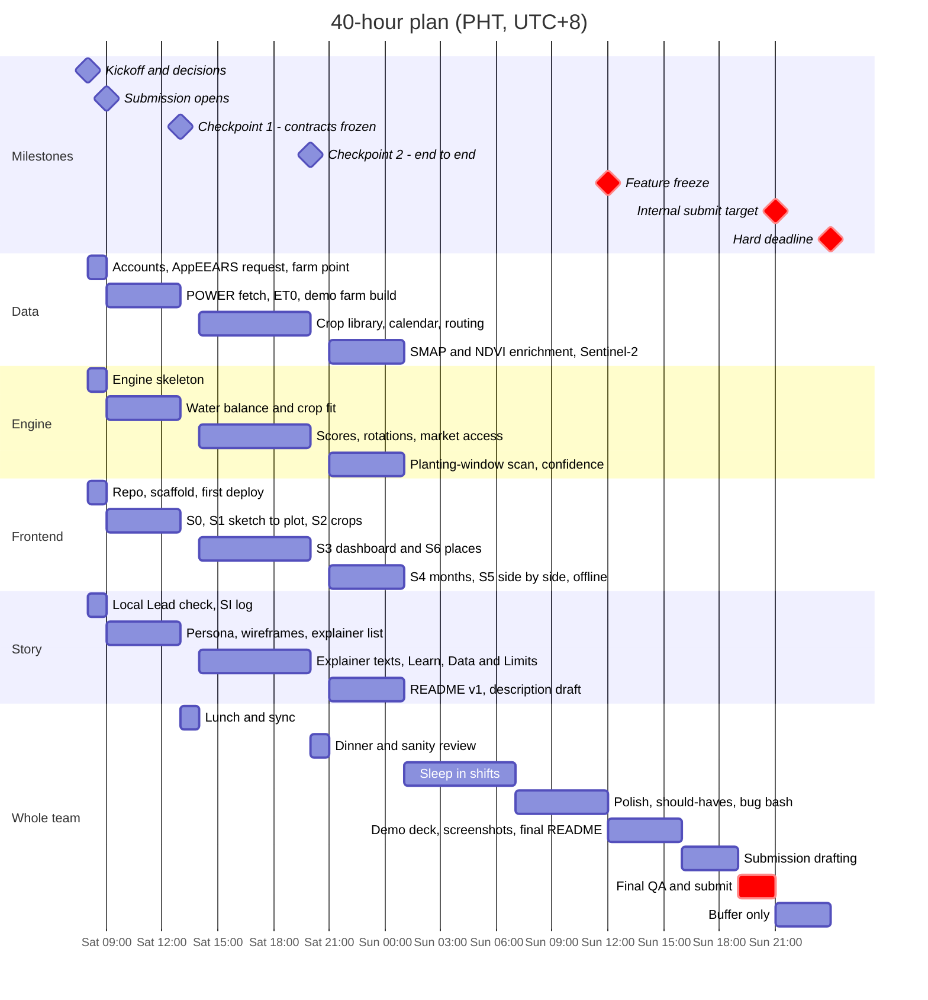

# 08 — 40-Hour Work Plan (all times PHT, UTC+8)

> Hard deadline: **Sun Nov 15, 11:59 PM PHT**. **Internal submit target: Sun 9:00 PM PHT.** The last 3 hours are buffer only.
> ⚠️ **First action:** ask the Iligan City Local Lead whether **local judging or presentations** happen earlier than the global deadline. If they do, move every milestone below earlier.

## Roles (4 tracks; merge if the team is smaller)

| Track | Owns | Merge rule |
|---|---|---|
| **Data lead** | `pipeline/`, site JSON, crop library + citations, AppEEARS/Sentinel-2 extracts, `03-data-sources.md` | With 3 people: Data + Engine |
| **Engine lead** | `app/src/engine/`, params + tests, explanation templates, `07-rotation-engine.md` | With 2 people: Data + Engine and Frontend + Story |
| **Frontend/UX lead** | App shell, screens, charts, PWA/offline, deploy | — |
| **Story lead** | Persona, copy and microcopy, Learn page, demo deck, README, submission fields, `si-usage-log.md` | Everyone reviews the final deck |

Team member names → fill in `docs/README.md` (they're needed on the demo slides).

## Timeline

### Saturday Nov 14

| Time | Block | Data | Engine | Frontend/UX | Story | Exit criteria |
|---|---|---|---|---|---|---|
| **08:00–09:00** | Kickoff | Make Earthdata accounts. **Submit the AppEEARS request.** Pick the demo farm point. | Read 07, set up the TS engine skeleton | Create git repo + GitHub, Vite PWA scaffold, deploy "hello" page | Read 01/02, message the Local Lead, start `si-usage-log.md` | **Decisions D1–D10 confirmed** (decision log). Repo is public. Deploy pipeline works. |
| 09:00 | — | — | — | — | — | *Submission opens. Create the project page and fill the Project Name early.* |
| **09:00–13:00** | Build 1 | **`app/src/data/power.ts`** (live monthly POWER fetch + parse, mm/day→mm, skip `13`, handle `-999`) + **`et0.ts`** (FAO-56 monthly) · Python `build_demo.py` for 1 demo farm | Water balance + crop fit on mock lot data, unit tests | **S0 Welcome + S1 map**: **freehand sketch → clean plot → draggable points**, tap-corners, pin fallback, multi-lot, live area + **S2 crops per lot**; IndexedDB store | Persona (2 lots), wireframes S0–S5, list of ⓘ explainers needed, slide template | **13:00 Checkpoint 1: data contracts frozen**; drawing a lot on a phone works; live fetch returns real data |
| 13:00–14:00 | Lunch + sync | | | | | Agree what's cut if behind |
| **14:00–20:00** | Build 2 | Crop library (8–12 crops, cited) **+ typical local planting calendar + perishability per crop**; demo farm enrichment (SRTM, trends); `routing.ts` (OSRM + offline estimate) | Scores, weights, A/B/C/D rotation options, **Market access (`access.ts`)**, explanation templates | **S6 destinations (add-anytime, from dashboard card / Edit farm) + transport + travel-time confirm**; **S3 Dashboard** per lot (incl. "Getting your harvest out" card); wired to engine + live data | **ⓘ explainer texts** for every dashboard card (incl. travel time); Learn + Data & Limits pages; disclaimers | **20:00 Checkpoint 2: S0→S3 end-to-end with real data** (ugly is OK) |
| 20:00–21:00 | Dinner + **sanity review** | Run the 07 §7 checks as a group | | | | Results believable? If not, fix the data before the UI |
| **21:00–01:00** | Build 3 | AppEEARS SMAP/NDVI into demo farm (if ready); Sentinel-2 image | **Planting-window scan** (07 §3b), confidence (P20/P80) | **S4 months picker + S5 side-by-side**; offline/PWA precache, mobile layout | S5 explainer texts, README v1, Detailed Description draft | S0→S5 works; dashboard opens offline on a phone |
| 01:00–07:00 | **Sleep in shifts** | At least 4–5 h each. Tired teams ship bugs. | | | | |

### Sunday Nov 15

| Time | Block | Focus | Exit criteria |
|---|---|---|---|
| **07:00–12:00** | Build 4 / Polish | Should-haves (SMAP vs POWER chart, NDVI bare-period view), accessibility (contrast, font size, tap targets), microcopy pass, bug bash | All Must + chosen Should items done |
| **12:00** | 🧊 **FEATURE FREEZE** | Only bug fixes after this | |
| 12:00–16:00 | Demo build | Screenshots or recording from the **deployed** app, 7-slide deck ([09](09-demo-plan.md)), final README, THIRD_PARTY.md | Deck reviewed by the whole team |
| 16:00–19:00 | Submission drafting | Fill every form field from `docs/submission/fields.md`; SI disclosure; NASA + partner data lists | Every link tested in incognito |
| 19:00–21:00 | Final QA + **Submit** | Final phone test offline; confirm all members registered at Iligan City; **click "Submit for Judging"** | ✅ **Submitted by 21:00** |
| 21:00–23:59 | Buffer | Emergencies only. Edits still count until 23:59, but don't risk a broken state. | |

## Checkpoint protocol (5 minutes each)

1. Demo the current state from the **deployed URL**, not localhost.
2. Each track: done, blocked, next.
3. If behind, **cut from the bottom of MoSCoW**. Never push the freeze or the submit time.

## Cut order if we fall behind

1. Regional map → 2. Cebuano labels → 3. SI summaries → 4. clustering → 5. ECOSTRESS → 6. fare/transport cost → 7. "Straighten?" → 8. backup/restore file → 9. NDVI view → 10. SMAP chart → 11. 3-year SHI chart → 12. scenario slider → 13. wet-season roads → 14. trips per harvest → 15. online routing (keep estimate + farmer confirm) → 16. priority chips → 17. optional lot details.
**Never cut:** short no-login onboarding (lots → crops → dashboard), draggable plot points, add-later harvest destination + transport + travel time, dashboard with ⓘ explainers, ≥3 rotation options including "your crops", your-months-vs-better-months, offline after onboarding, disclaimers, NASA data provenance, submission QA.
**If freehand sketching is fighting us by Sat 13:00:** make **tap-corners** the main way (same draggable points afterward) and keep the sketch as a bonus. If all drawing fails, "drop a pin + type area".
