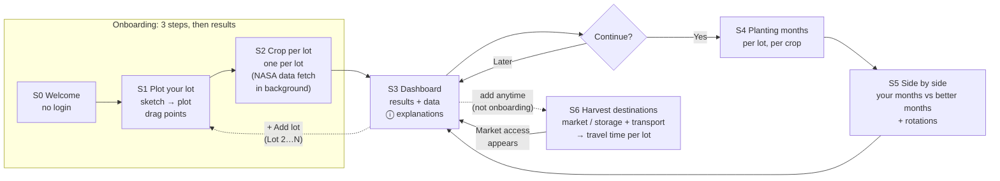

# 11 — User Flow & Screens (team-defined onboarding)

> **Source of this flow: the team** (2026-11-14). Items marked **[suggested]** are planning additions to cover a challenge requirement. The team can accept or drop them (see `decision-log.md` D12–D16).

## Principles

- **No login, no account, no sign-up.** The farmer opens the app and starts. All farm data **stays on the phone** (app storage). Nothing personal goes to a server.
- **Onboarding needs a connection once** (map + NASA data fetch). After that, **the dashboard and comparisons work offline**.
- Every chart and number carries a **"ⓘ What am I looking at?"** explainer: what the data is, where it comes from (which satellite or model), how to read it, and its limits.
- Plain language, big tap targets, icons and local crop names. The tool **supports and doesn't replace** the farmer's judgment and the agricultural technician.

## Flow overview



## Screens

### S0 — Welcome
- One line on what the app does, plus a **"Start"** button. **No login or account step.**
- Privacy line: "Your farm information stays on this phone."
- **[suggested]** Language selector (English now; Cebuano labels as stretch).
- Returning user: goes straight to S3 Dashboard (data loaded from the phone).

### S1 — Plot your lot on the map
- Satellite map. **"Find me"** (GPS, which also works offline), or move the map with your fingers. No place-name search: it would send what the farmer types to a third-party geocoding service (#21).
- **Draw the lot: three ways, one result (an editable plot):**
  1. **✏️ Sketch it (main way, team-defined):** tap **Draw**, then trace roughly around the lot with one finger. On release, the app **analyzes the sketch and converts it into a clean land plot**: it closes the loop, smooths the shaky line into a few corner points, and fixes crossed lines (details in 06, "Freehand sketch → plot").
  2. **📍 Tap the corners:** tap each corner, then tap the first point to close.
  3. **Fallback:** **"Drop a pin + type the area"**, if drawing is hard on the device.
- **Zoom check:** Draw and Tap corners start only when the map is close enough to see the lot's edges (zoom 16 or closer). Further out, the app zooms in first and asks the farmer to centre the lot and tap again.
- **Adjust the plot:** a saved lot shows as a **clean outline, without points**. **Adjust** shows the **big draggable corner points**: **drag a point** to move it, **tap the small dot on an edge** to add a point there, **long-press a point** to remove it. The area (hectares) updates live while dragging. **Done** hides the points again. **Undo** and **Redraw** are always visible.
- **[Could]** "Straighten?" If the sketch is nearly a rectangle, offer to snap it to a clean rectangle (still adjustable).
- While in Draw mode, **one finger draws and two fingers move/zoom the map**, so sketching doesn't fight with panning.
- **One lot in onboarding** (D32, proposed): the map fills the screen. Only a round **back** button (top left) and **Find me** + zoom (top right) float on it. The step, the hint, and big labelled buttons sit in one panel at the bottom (a card in the lower right on a wide screen). The farmer draws **Lot 1** (tap its name in the panel to rename it), then **Next → S2**.
- **More lots come from the dashboard:** **"+ Add lot"** on S3 opens this same map for Lot 2…Lot N, then S2 for that lot's crops. Each lot can be **renamed, re-adjusted, redrawn, or deleted** from its lot menu on the dashboard or from Edit farm.
- **[suggested]** Optional "Lot details", each defaulting to **"I don't know"**:
  - Land type: lowland/paddy · upland · sloping
  - Water: rain only · some irrigation · full irrigation
  - Soil feel: sandy · loamy · clayey
  *(These improve the water and erosion estimates. "I don't know" uses defaults and lowers the confidence badge.)*
- Next → S2. **Background:** the app starts fetching NASA data for each lot's center point (see 06).

### S2 — What do you plant on each lot?
- One section per lot. First **one search box** over our crop list and the FAO Ecocrop names (offline); a name the app doesn't know can still be chosen as typed (not scored). Below it, **Top 3 for this lot**: the library crops that suit the lot best on its NASA data, each with its fit and best planting months (shown once the lot's data is on the phone). (#152) Poor fit crops, and crops whose water use can't be checked, are never listed; when every crop is a Poor fit in every month (e.g. a desert), S2 says **none of our crops grow well here** and names the main trouble (too dry, too cold, too hot, too wet).
- **A lot on sea or ice:** when NASA POWER has no root-zone soil wetness for the lot in any month, the data line says "This spot looks like sea or ice, not farmland", the top crops are hidden, and a **Move lot** button opens the lot on the map. Only open water far from land is caught: a POWER probe (2026-11-15) found no soil wetness in the central Sulu Sea, the Celebes Sea and off Samar, but Manila Bay, the Sibuyan, Visayan, Camotes and Bohol Seas, Moro Gulf, Laguna de Bay and Lake Lanao read as land (their ~50 km grid cells hold land). A very small island can read as sea (Pag-asa Island did), so the note says so. A lot that was moved shows the normal "Getting NASA climate data" line until its new data arrives.
- **One crop per lot** (D13, changed by the team 2026-11-14). Choosing a crop replaces the lot's crop; a farm saved earlier keeps its crops until one is chosen.
- Progress chip per lot: "Getting climate & satellite data for Lot 1… ✓".
- Next → S3. **Onboarding ends here.** Harvest destinations are added later (S6) to keep onboarding short.

### S3 — Dashboard (results + data + explanations)
Per lot (tabs or swipe cards). **"+ Add lot"** sits next to the lot tabs (opens S1 for the new lot, then S2 for its crops), and each lot has a menu: **Redraw · Rename · Delete** (D32).
A lot with no NASA soil data (sea or ice, as on S2) shows a note and **Move <lot> on the map** instead of results; the farm map labels it "No soil data".

| Card | Shows | "ⓘ What am I looking at?" explains |
|---|---|---|
| **Lot snapshot** | Area, location, 12-month **rain vs crop water need** bars; dry and wet months highlighted | Rainfall and evaporation estimates from NASA POWER (satellite + weather model), 2001–2025 average; how to read the bars; ~50 km resolution caveat |
| **Soil moisture** | Root-zone wetness by month (0–1), dry-stress months marked | What root-zone soil moisture is; satellite/model vs a hand test in the field |
| **Your crops here** | Each selected crop: **Good fit / Watch out / Poor fit**, with the 1–2 main reasons (water, heat, waterlogging, **distance to market**) | How "fit" is calculated in plain words, and which data drives it |
| **Getting your harvest out** | **Before S6:** an empty-state invite: "Where do you sell or store your harvest? **Add a place** to see travel time and which crops suit the trip." → opens S6. **After S6:** travel time per lot → each destination (mode, source label); which crops suit that trip (e.g. "Tomato spoils fast: 1 h 10 min is long", "Dried mungbean stores well"); **[Should]** trips needed per harvest; **[Should]** months when heavy rain may slow the roads | How travel time was found (road route / estimate / your time); why perishable crops need short trips; that transport costs aren't calculated unless the farmer enters a fare |
| **Recommendations** | **≥3 rotation options**: *Your crops (typical local calendar, assumed)* vs 2–3 alternatives (e.g. "add mungbean after rice"). Each has **Why this? · Evidence · Benefits · Unknowns · Check locally** and a confidence badge | Why each option was suggested; what we don't know; what to confirm with the technician |
| **[suggested] What matters to you?** | 4 chips/sliders: save water · build soil · extra income · less work. Re-ranks the recommendations instantly (offline) | Covers the challenge's "farmer priorities" requirement |
| **Continue prompt** | "Want a sharper comparison? Tell us **which months you plant**." → **Continue** / **Later** | — |

> Until the farmer gives their months, the "Your crops" option uses a **typical local planting calendar** for each crop (team-curated and cited), clearly labeled **"assumed"**. That keeps the required *existing rotation* comparison working even if the farmer stops here.

### S4 — When do you plant? (optional)
- For each lot → each crop picked in S2: a **12-month strip**. Tap the planting month, then the harvest month.
- **"+ Add another season"** for crops planted more than once a year (e.g. rice twice).
- Overlapping crops on the same lot count as **planted together** (intercrop), which is allowed.
- Next → S5.

### S5 — Your months vs better months (side by side)
Per lot, per crop:

```
 ┌──────── YOUR MONTHS ────────┐   ┌──────── BETTER MONTHS ───────┐
 │ Rice  Jun → Sep              │   │ Rice  May → Aug               │
 │ Rain covers 74% of need      │   │ Rain covers 88% of need       │
 │ Dry-stress months: Sep       │   │ Dry-stress months: none       │
 │ Heat-risk months: —          │   │ Heat-risk months: —           │
 │ Fit score 62                 │   │ Fit score 81  (+19)           │
 │ [rain vs need chart]         │   │ [rain vs need chart]          │
 └──────────────────────────────┘   └───────────────────────────────┘
  Why: "Planting about a month earlier avoids the September dry spell seen in most years (NASA POWER 2001–2025)."
  Confidence: Medium. Check locally: water availability for land preparation in May?
```
*(Numbers above are illustrative placeholders. Real values come from the engine.)*

- **Whole-lot calendar**: *Your calendar* vs *Better timing* vs *Alternative rotation(s)*. This is the challenge's **"compare ≥3 strategies including the existing one"**, now using the farmer's **actual** months.
- Every card keeps the **ⓘ explainer** and the **Why / Evidence / Benefits / Unknowns / Check locally** fields.
- "Better months" never ignores the farmer's other crops. The suggestion must still fit the lot's calendar (see 07 §3b).
- **[Should]** Harvest-month check: if a harvest falls in a heavy-rain month (NASA rainfall data), flag slower roads and harder drying (rice, corn), using the farmer's travel time to that destination.

### S6 — Where does your harvest go? (add anytime, **not part of onboarding**; transport constraint, team-defined)
- **Opened from:** the dashboard's "Getting your harvest out" card (**Add a place**), or **Edit farm → Places**. Never forced. The farmer can skip it forever.
- **Pin each destination** on the map: **Market**, **Storage** (bodega, dryer, warehouse), **Buyer / trading post**, **Cooperative**. **"+ Add place"** for more than one.
- For each destination: **"How do you usually get there?"** Pick one: Walking · Carabao / cart · Bicycle · Motorcycle (incl. habal-habal) · Tricycle · Jeepney / bus · Truck / pickup.
- The app shows the **estimated travel time from each lot**:
  ```
  Lot 1 → Poblacion market   Motorcycle   ~55 min (road route)   [ Looks right ✓ ]  [ Change: __ min ]
  Lot 2 → Poblacion market   Motorcycle   ~1 h 10 min (estimate) [ Looks right ✓ ]  [ Change: __ min ]
  ```
  *(Illustrative values.)* The label says how the time was found: **"road route"** (online routing), **"rough estimate"** (offline formula, also works with no signal), or **"your time"** (farmer-entered, always wins).
- **[suggested]** Optional: "Usual load per trip" (defaults by mode) and "One-way fare" (if they pay for the ride). Both default to "I don't know".
- Save → back to the dashboard. Market access scores and the transport explanations appear, and the recommendations re-rank.
- If added offline: use the rough estimate now and quietly upgrade it to a road route when back online (unless the farmer already entered their own time).
- Until a destination exists, **market-access scoring is off**. The weights renormalize and the dashboard says "Add a place to include travel to market."

### Always available
- **Edit farm**: lots, crops, months, **places (harvest destinations)**.
- Offline badge + "Data updated <date>".
- **Learn** page (glossary) + **Data & limits** page.
- **[suggested, Could]** "Save a backup file / restore". With no account, clearing browser data would erase the farm.

## What this flow changes elsewhere

| Doc | Change |
|---|---|
| 05 MVP scope | Flow and MoSCoW updated to match this |
| 06 Architecture | Live NASA POWER fetch per lot by the app, lots + destinations stored as GeoJSON on the device, map drawing library, optional OSRM routing (CORS verified) |
| 07 Rotation engine | Per-lot inputs; two stages (assumed calendar → actual months); planting-window analysis; **market access & transport (§3c)** |
| 08 Schedule | Map/lot drawing and live fetch moved early (highest UI risk); S6 + travel module in Build 2 |
| 09 Demo | Demo walks through S1 → S5 |
| 10 Risks | Map drawing on phones; onboarding needs a connection; nearby lots share one climate cell; data loss with no account; rural road gaps in OpenStreetMap; speed assumptions |
