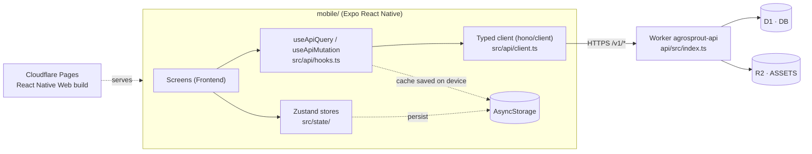

# 12 · Infrastructure: Cloudflare, API, hooks and state

> How the app connects to Cloudflare, how to use the API plumbing, and what to do when something breaks. Tracked in issue #2.
> Plumbing only: feature endpoints, tables, screens and feature state belong to each track.

## Overview



- **Android app** and **web build** come from the same `mobile/` code. Pages hosts the web build.
- Both call the same **Worker** API. The Worker is the only thing that talks to D1 and R2.
- Farm data stays on the phone (D12): it lives in Zustand stores, not in D1.

## Environments

| | Production (`main`) | Preview (every other branch / PR) |
|---|---|---|
| Web | https://agrosprout.inovsea.com | `https://<branch>.agrosprout.pages.dev` |
| API | https://api.agrosprout.inovsea.com | https://api-preview.agrosprout.inovsea.com |
| API fallback | https://agrosprout-api.bitter-silence-900e.workers.dev | https://agrosprout-api-preview.bitter-silence-900e.workers.dev |
| D1 (`DB`) | `agrosprout-db` | `agrosprout-db-preview` |
| R2 (`ASSETS`) | `agrosprout-assets` | `agrosprout-assets-preview` |
| `EXPO_PUBLIC_API_URL` | production API | preview API |

Preview deploys never touch production data. Cloudflare account: inovsea (admin@inovsea.com), which also holds the `inovsea.com` DNS zone. The `workers.dev` URLs are a fallback if a custom domain has a problem.

## Local development

Two terminals:

```bash
# 1. API (http://localhost:8787), with local D1 and R2 (no Cloudflare login needed)
cd api
npm install
cp .dev.vars.example .dev.vars      # only if you need secrets
npm run db:seed                     # applies migrations + seed to the local D1
npm run dev

# 2. App
cd mobile
npm install
cp .env.example .env.local          # EXPO_PUBLIC_API_URL=http://localhost:8787
npx expo start                      # press w for web, or scan with Expo Go
```

On a phone with Expo Go, `localhost` is the phone itself. Set `EXPO_PUBLIC_API_URL` to your laptop's LAN IP (e.g. `http://192.168.1.20:8787`) and run `npm run dev -- --ip 0.0.0.0` in `api/`, or point it at the preview API.

**Before every PR:** run `npm run check` in each folder you touched (typecheck + lint; in `mobile/` it also runs the Node tests in `src/**/*.test.ts`). There is no hosted CI. Cloudflare runs the same check during the build and refuses to deploy a broken commit.

## Usage

### Add an API route

1. Copy `api/src/routes/_template.ts` to `api/src/routes/<area>.ts`.
2. Validate input with `validate("query" | "json" | "param", zodSchema)`. Bad input returns `400 invalid_request`.
3. Answer with `ok(c, data)` or `fail(c, status, code, message)`. Every response is `{ ok: true, data }` or `{ ok: false, error: { code, message } }`.
4. Use `c.env.DB` (D1) and `c.env.ASSETS` (R2).
5. Mount it in `api/src/index.ts` by chaining onto `v1`: `.route("/<area>", area)`. Chaining is what carries the route's types to the app.
6. `npm run check` in `api/` and in `mobile/`.

All `/v1` routes get CORS (web app domains + localhost) and a per-IP rate limit (`429 rate_limited`).

### Add a D1 migration

```bash
cd api
npm run db:migrations:create -- <name>    # creates migrations/000X_<name>.sql
npm run db:migrate:local                  # apply locally
```

Merging to `main` applies pending migrations to `agrosprout-db` automatically before the Worker deploys. Preview branches apply them to `agrosprout-db-preview`. Migrations are forward-only: to undo, write a new migration.

### Add a secret

```bash
cd api
npx wrangler secret put EARTHDATA_TOKEN               # production
npx wrangler secret put EARTHDATA_TOKEN --env preview # preview
```

Add the name (no value) to `api/.dev.vars.example`, put the real value in your local `api/.dev.vars`, then run `npm run cf-typegen` so `c.env.EARTHDATA_TOKEN` is typed. Never commit `.dev.vars`.

### Call the API from the app

```ts
import { api } from "../src/api/client";
import { useApiQuery, useApiMutation } from "../src/api/hooks";

const health = useApiQuery(["health"], ({ signal }) => api.v1.health.$get(undefined, { init: { signal } }));
// health.data is typed from the Worker; health.error is an ApiError { code, message, status }

const save = useApiMutation((input: { id: string }) => api.v1.things.$post({ json: input }));
save.mutate({ id: "x" });
```

- Never call `fetch` directly for the API. The hooks handle the base URL, timeout (15 s), error shape and offline cache.
- **Query keys:** add one key factory per API area in `keys` (`src/api/hooks.ts`), e.g. `keys.power.lot(lat, lon)` → `["power", lat, lon]`. Mutations invalidate a whole area with `queryClient.invalidateQueries({ queryKey: keys.power.all })`.
- **Freshness:** pass `staleTime: STALE.DAY` (or `MINUTE`, `HOUR`, `FOREVER`) from `src/state/query-client.ts` instead of raw numbers.
- **Retries:** network errors and 5xx retry once; 4xx never retry; mutations never retry.
- **Offline cache:** every successful query is saved to the device unless it sets `meta: { persist: false }` (use that for live-only data like `/v1/health`). The saved cache is dropped automatically when the app version in `app.json` changes, or when `CACHE_SCHEMA` is bumped.
- **Online/focus:** on Android the app tells TanStack Query when the connection drops (NetInfo) and when it comes back to the foreground (`src/net/sync.ts`); the browser handles this on web.
- **Errors:** `error.code` is the Worker's code (`invalid_request`, `rate_limited`, `not_found`, ...) or `network_error` / `timeout` / `aborted` from the client.
- **Config:** read env values only through `src/env.ts` (`API_URL`, `APP_VERSION`, `IS_WEB`, `IS_NATIVE`), never `process.env` directly.

### TanStack Query or Zustand?

| Use | For | Where |
|---|---|---|
| **TanStack Query** (via `useApiQuery`) | Anything that comes from the API | `src/api/` |
| **Zustand** (via `createPersistedStore`) | Anything the farmer creates or chooses: lots, crops, months, settings | `src/state/` |

Both are saved to the device (AsyncStorage on Android, `localStorage` on web). Copy `src/state/example-store.ts` to start a store and **export it from `src/state/stores.ts`**. When a store's saved shape changes, bump `version` and pass a `migrate(old, fromVersion)` that converts old data. Bump `CACHE_SCHEMA` in `src/state/query-client.ts` after a breaking API change.

### Offline data rules

How the pieces behave, checked against the installed library code (zustand 5.1.0, TanStack Query 5.107.1, AsyncStorage 2.2.0) and covered by `npm test` in `mobile/`:

| Rule | Why |
|---|---|
| **Anything the dashboard needs offline goes in a Zustand store**, including per-lot NASA POWER data (`LotData`) and its fetch date. Save it as soon as it is fetched (06-architecture offline checklist). | The TanStack Query cache is a convenience cache: it is deleted when the app version changes, when `CACHE_SCHEMA` is bumped, after **7 days** (`QUERY_CACHE_MAX_AGE`), or if it cannot be read. Stores have none of these limits. |
| **Screens only render after every store has loaded.** The root layout waits (`useStoresReady`, usually a few milliseconds). | With plain zustand `persist`, a change made before saved data finishes loading writes the empty defaults over the farmer's saved data. A test in `src/state/persist-core.test.ts` reproduces it. |
| **Nothing is written until saved data has been read**, even if a store is created later than launch. | Same reason. The early change is dropped with a console warning instead of erasing saved data. |
| **Saved data is backed up before it is migrated or replaced.** If it is unreadable, from another `version`, or `migrate` throws, the original text is kept under `agrosprout-<store>:backup:<time>` and the store starts from its defaults. | Plain zustand drops old-version data silently, and never finishes loading if `migrate` throws. |
| **If device storage cannot be read at all, nothing is saved** until the next launch (status `failed`). | Writing then could overwrite data that is still on disk. |
| **Lots fetched while offline stay `data_status: "pending"`** and are fetched again with `onReconnect` / `useOnReconnect` (`src/net/reconnect.ts`). | 06-architecture: "fetch automatically when back online". Online state comes from NetInfo on Android and the browser on web. |
| **Direct calls (NASA POWER, OSRM) use `fetchWithTimeout`** from `src/net/fetch.ts` (15 s default) and pass the query's `signal`. | A cancelled or hung request stops instead of waiting forever. |
| **Keep stores small.** Store the processed monthly values, not the raw ~33 KB POWER response. | AsyncStorage on Android is capped at 6 MB in total by default (`AsyncStorage_db_size_in_MB`). |

`useHydrationReport()` (`src/state/hydration.ts`) tells a screen whether each store loaded normally (`ready`), was restored from a backup (`recovered`) or could not be read (`failed`), so the Frontend can show a message. No UI is included.

## Why it is set up this way

The plumbing follows patterns from two larger React Native apps (Bluesky's social app and delvo.ph), kept to what a 40-hour build needs: one env module, key factories, named freshness values, no retries on 4xx, NetInfo/AppState sync, saving only successful queries, and versioned stores. Their heavier parts (MMKV, OpenAPI codegen, offline mutation queues, custom rollouts) are left out on purpose.

## Deployments

All automatic, through Cloudflare's own Git integration. No GitHub Actions.

| What | Trigger | Build | Result |
|---|---|---|---|
| Web (Pages) | push touching `mobile/` or `api/` | `npm ci && npm ci --prefix ../api && npm run check && npx expo export --platform web` | `main` → production; other branches → preview URL (posted on the PR) |
| API (Workers Builds) | push touching `api/` | `npm ci && npm run check` | `main` → `npm run deploy` (migrations + deploy); other branches → `npm run deploy:preview` |

- A failed build leaves the last good version live.
- Env vars for the web build (`EXPO_PUBLIC_API_URL`, `NODE_VERSION=22`) are set in the Pages dashboard, not in the repo.
- Docs-only commits deploy nothing.

## Debugging

- **Logs:** Cloudflare dashboard → Workers & Pages → `agrosprout-api` → Logs (Workers Logs is on).
- **Live tail:** `cd api && npm run tail` (or `npm run tail:preview`). Needs Cloudflare access, see below.
- **Health:** `GET /v1/health` reports the environment and whether D1 and R2 respond.

## Contingency

| Problem | What to do |
|---|---|
| **Bad deploy (web)** | Dashboard → Workers & Pages → `agrosprout` → Deployments → pick the last good one → *Rollback to this deployment*. |
| **Bad deploy (API)** | Dashboard → `agrosprout-api` → Deployments → pick the last good version → *Deploy*. Or `npx wrangler rollback`. |
| **Cloudflare build fails or is stuck** | Deploy from a laptop (needs Cloudflare access): web `cd mobile && npx expo export --platform web && npx wrangler pages deploy dist --project-name agrosprout --branch main`; API `cd api && npm run deploy`. |
| **D1 migration failed** | `npx wrangler d1 migrations list agrosprout-db --remote` to see what ran. Fix forward with a new migration. To restore data: `npx wrangler d1 time-travel restore agrosprout-db --timestamp <before the bad migration>`. |
| **API down during judging** | The app keeps working from the cached API data and the on-device stores (offline-first). The bundled demo farm still loads. Show `/v1/health` once it is back. |
| **Rate limit hit during the demo** | Raise `limit` in `api/wrangler.jsonc` (`ratelimits`) and merge, or roll back to a version with a higher limit. |
| **Custom domain problem** | Use `https://agrosprout.pages.dev` for the web app and the `workers.dev` API fallback URLs, and set `EXPO_PUBLIC_API_URL` to the fallback in the Pages settings. |
| **Free-tier limits** | Workers: 100k requests/day. D1: 5M rows read/day, 100k rows written/day, 5 GB. R2: 10 GB, 1M writes and 10M reads per month. Pages: 500 builds/month. If one is hit, fall back to the cached data and the demo farm, and tell the infra owner. |

## Access

- **Using the app and API:** nothing needed. The URLs above are public.
- **Local development:** nothing needed. `wrangler dev` uses local D1 and R2.
- **Deploying:** nothing needed. Merge a PR and Cloudflare deploys it.
- **Dashboard, logs, `wrangler tail`, manual deploys, remote D1 commands:** ask the infra owner for a Cloudflare account invite. Each person gets their own login (`npx wrangler login`). API tokens are never shared in chat or committed.
